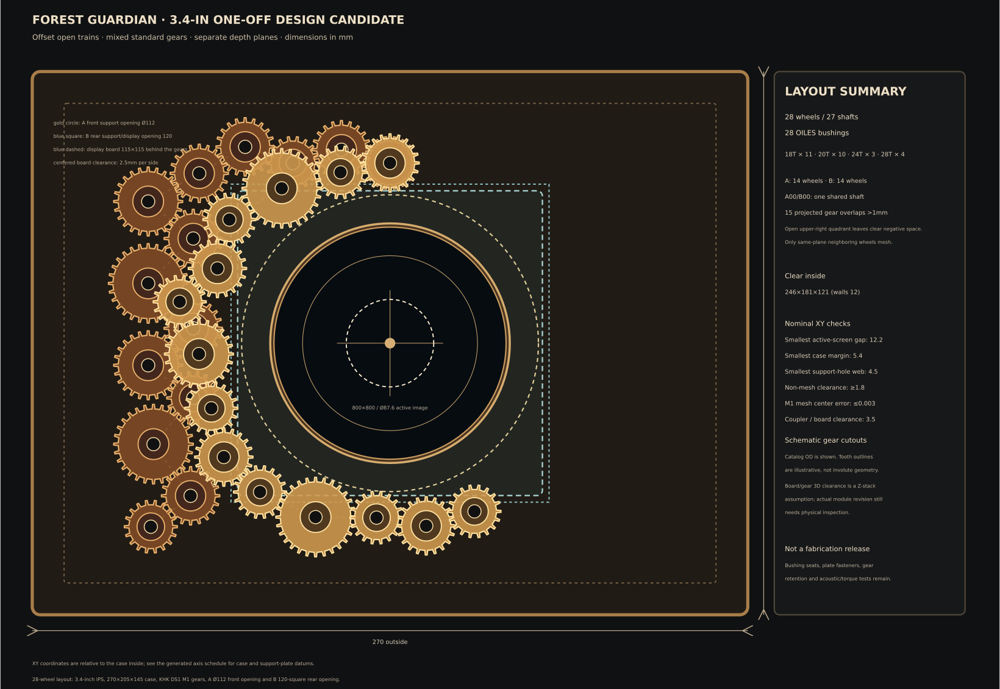

# Forest Guardian / DialCanvas 一台試作設計ベースライン

更新日：2026-10-21

状態：**寸法入りの候補設計を統合。製作図・発注確定・実機受入ではない。** 量産設計は対象外。

この文書と参照図を、現時点の一台試作候補の原本とする。既製品の型番、必要数量、名目寸法、配線の分け方、ファームウェアの方式を揃えた。3.4Cのメーカー公称外形115×115mmを使った平面・配置設計は確定基準とし、現物到着待ちで止めない。公称寸法では決まらない嵌合、荷重、騒音、温度、背面奥行きは、取付・加工・動作の受入項目として残す。

歯車は全POMを現行の最安基準にする。外観の金属色を増やす既製真鍮ギア案は、6mm軸とZ配置変更の費用を含めて別候補に比較したが、この基準BOMにはまだ採用していない（詳細は[歯車成立性ノート](../03-mechanical/gear-feasibility.md#外観用の既製真鍮歯車案未採用)）。

## 1. 目標構成

- 外形の基準：幅270 × 高さ205 × 奥行145mm。内寸246 × 181 × 121mm（壁厚12mm）。
- 表示：Waveshare ESP32-P4-WIFI6-Touch-LCD-3.4C（SKU31523）、3.4型円形800×800 IPS、メーカー公称基板外形115×115mm/表示領域87.6mm角、microSD搭載。後面支持板の120×120mm開口に中央配置し、公称2.5mm/辺のすき間を設計余裕とする。画面ガラスのCAD基準面はz=40mm。操作用タッチは使わない。ソフトウェア基準はESP-IDF v5.5.5、Waveshare BSP 3.0.1、LVGL 9、Espressif `esp_jpeg` 1.3.1。
- 歯車：KHK DS1のM1 POM歯車28個、5mm軸、二枚の透明支持板。前列A/後列Bを各14個にし、左側と下側へ偏らせ、別Z面の歯車を平面投影で15組重ねる。
- 駆動：Adafruit NEMA-8 #4411とTMC2209 #6121を一台分の候補にする。出力軸目標1.6rpm。静音性と必要トルクは実機未測定。
- 給電：USB-C PD入力から9Vを要求する案。9Vをモーター枝と5V変換枝へ分け、表示基板は#3411送電側ブレークアウトと0.3m C-Cケーブルから3.4CのUSB TO UART Type-C入力へ給電する。PD契約、CC抵抗変更、枝ヒューズ、総電流、熱は未受入。
- 文字盤：ユーザーのJPGをmicroSDにコピー。ESP-IDFの公式BSPとLVGL 9を使い、文字盤の読込・時計・針・操作だけを本機用に実装する。
- 木箱、曲面意匠、支持板、透明前面ガード、配線ハーネスは一台分を加工する。歯車、画面、モーター、ドライバー、電源変換、カップリング、軸、ブッシュ、LED、操作部は既製品を優先する。

購入候補、個数、価格、販売先は[未選定部品調達候補（2026-10-21）](unselected-parts-procurement-plan-2026-10-21.md)を参照。部品候補を選んだことは、適合・性能・安全性の受入や発注許可を意味しない。



関連図：[平面配置SVG](../03-mechanical/irregular_layered_gear_layout.svg)、[軸方向断面SVG](../03-mechanical/layered_gear_axial_section.svg)、[3.4C公称外形の当て込み図](../03-mechanical/display_board_envelope.svg)、[表示基板インターフェース](../03-mechanical/display-board-interface.md)、[前列支持板テンプレート](../03-mechanical/gear_support_plate_A.svg)、[後列支持板テンプレート](../03-mechanical/gear_support_plate_B.svg)、[軸座標CSV](../03-mechanical/gear_axis_schedule.csv)。図は名目配置確認用で、CAMへ直接渡す加工データではない。

## 2. 既製品BOM候補

「選定候補」は購入先で型番・価格を確認した意味で、発注・現物適合・性能受入を意味しない。価格は調査時の表示、送料を含まない。全行の購入URLと価格条件は[調達候補表](unselected-parts-procurement-plan-2026-10-21.md)に記載。

| 区分 | 型番・仕様 | 数量 | 価格・小計 | 判断と残作業 |
|---|---|---:|---:|---|
| 表示・主制御 | Waveshare ESP32-P4-WIFI6-Touch-LCD-3.4C / SKU31523 | 1 | US$64.99（Waveshare公式、Out of Stock）/ £62.40税込（The Pi Hut、Sold out） | IPS 800×800、円形、microSD SDIO、USB-C。3.4型基準。2026-10-21に確認した2店はともに在庫切れ。実基板の改版、端子位置、奥行、発熱、画質、連続描画を測る。|
| 表示基板取付 | タカチ HES3-10 + 大里 M3×12/M3×6ステンレスなべ小ねじ | 4点、各パック購入 | **¥822税込** | スペーサー4本を使う候補。3.4Cの穴径・位置とねじ長さの適合確認が残る。HES3-10に特別運賃¥660表示。|
| 文字盤媒体 | KIOXIA microSDHC 32GB Class 10/U1 | 1 | ¥2,390税込 | 文字盤JPGをPCでコピーする市販カード候補。カード読込・破損時復帰を確認。|
| 平歯車 | KHK DS1-18 / DS1-20 / DS1-24 / DS1-28、M1、POM、20°、歯幅6mm、全長12mm、5mm穴 | 11 / 10 / 3 / 4 | ¥260 / ¥260 / ¥260 / ¥280（税別）、**計¥7,360** | 2025-12-01適用のKHK価格表。成形穴は負公差。初回は歯車を数個だけ使い圧入状態を確認。DS1-16は穴径4mmのため除外。|
| 回転ブッシュ | OILES #80 80B-0508、内径5 / 外径7 / 長さ8mm | 28 | ¥51税別/個、**計¥1,428** | 前後各14点。A00/B00の共有複合軸だけ前後2個で支持。OILES推奨の軸h7・ハウジングH7を、透明PC板で成立するか試験する。|
| 軸材 | SUS303 h7平行ピン5×28mm（4本入）/ 5×60mm（2本入） | 7パック / 1パック | ¥4,151 / ¥593税込 | 5×28は26本必要、2本予備。共通軸は5×60規格ピンをモーター側で1.5mm切り、58.5mm仕上げ。歯車位置を維持する。|
| 軸止め/スラスト | KANA KSC0505 + POM M5×10×1mmワッシャー | カラー26個 / ワッシャー26枚入 | ¥5,408 / ¥549税込 | カラーの止めねじ、支持板との摩擦、軸方向すき間を試験。|
| モーター | Adafruit NEMA-8 #4411 | 1 | 税込換算¥3,592 | 200step/rev、4mm軸、0.6A/相。低速始動・負荷余裕・共振音・温度を試験。|
| モータードライバー | Adafruit TMC2209 breakout #6121 | 1 | 税込換算¥1,612 | STEP/DIR/EN、MS1/MS2開放で1/8、SPRD開放でStealthChop。EN HIGHで出力禁止。約0.3A RMSを評価開始点とし、実電流を測定。|
| カップリング | NBK MJT-14-RD-4-5、4mm↔5mm、外径14mm、全長22mm、ハブ長7mm | 1 | ¥2,088税込 | z=48–70mm。共通軸58.5mm仕上げ、両側7mm挿入。NEMA-8取付面z=72mmとして2mmを露出。基板公称外形まで3.5mm、背面余裕16mm。現物の保持・偏心・振動は要確認。|
| USB-C PD | Anker 511 30W + ELECOM MPA-CC10PNBK 60W C-Cケーブル + HUSB238 #5807 | 各1 | ¥2,790 + ¥1,720 + ¥1,265税込 | 9V/3A要求設定。9V時の供給上限は27W。契約・電流・温度は未受入。|
| 5V変換 | Pololu D24V50F5 #2851、5V/5A定格 | 1 | 税込換算¥5,650 | 旧#4082から更新。5A定格は部品能力の候補で、閉箱連続出力とシステム容量を実測する。|
| 5V出力端子台 | Pololu #2494、5極/2.54mmねじ端子台2個入り | 1袋 | **US$4.37** | #2851に1個、1個予備。端子穴ピッチと周辺クリアランスを照合してからはんだ付けする。|
| 表示基板給電用USB-C送電基板 | Pololu USB 2.0 Type-C Connector Breakout #3411 (usb07b) | 1 | **US$3.95** | #2851の5Vから3.4CのUSB TO UART Type-C入力へ給電。標準出荷は5.11kΩ Rdの受電側なのでCC抵抗を送電側Rpへ変更する。抵抗値と枝ヒューズは実測後に選ぶ。|
| 表示基板の内部ケーブル | ELECOM MPA-XCCECSS03BK、C-C、0.3m | 1 | **¥1,430税込** | #3411から表示基板の給電口まで接続。5V専用。|
| 暖色照明 | DFRobot FIT0836、5V暖色LEDストリップ、60LED/m | 1m品から約330mm | 税込換算¥1,080 | 仕様上限4W/mから約1.32W/0.264A。拡散部材と木部温度を確認。|
| LED拡散材 | 光 A032-2US 乳白半透明アクリル、2mm、160×180mm | 1枚 | ¥472税込 | 小片へ切り出す既製品候補。可燃性のため、LEDとの距離を確保し閉箱温度を測定。|
| 枝保護/配線 | エーモン3367 MINIヒューズホルダー×4、UL1007 AWG22赤黒10m各1巻 | 各1式 | ¥2,196 + ¥1,912税込 | 入力、モーター、5V画面、LED用のホルダー候補。ヒューズ定格は実測後に決定。|
| 電源分岐端子 | WAGO 221-413 + 221-503固定キャリア | 各4個 | **約¥1,914税込** | 9V+/9V GND/5V+/5V GNDの4節点。税別単価¥124/¥311から税込換算。＋側の枝保護、GND経路、配線保持を確認。|
| 着脱背面板/ねじ | ラワンT2 4×300×300mm + 3.1×13mm超低頭木ねじNI(中) | 各1パック | **¥691税込** | 270×205mm板を6点で既存12mm箱材の連続桟へ止める候補。下穴・端距離・反り・貫通なしを確認。|
| 操作 | ALPS EC11E15244G1 + Sato Parts K-8075-6.1 + NKK MN11SS1W01×2 | 各1式 | 約¥3,209税込 | エンコーダーで文字盤選択/確定、長押しでギアON/OFF。スイッチはモーター枝と照明枝。パネル穴・操作位置は現物確認。|
| 時刻保持 | Adafruit DS3231 #3013 + Maxell CR1220.1BS | 1式 | 約¥3,370税込 | GPIO28/29のI2C1候補、3.3V給電、0x68。起動時に有効なRTC時刻をシステム時刻へ戻し、SNTP同期後にRTCを更新するソースを追加。CR1220はDS3231基板自身のホルダーのみ。3.4CのRTC充電端子は使わない。 |

円建て価格既知分は、木箱材・保護板・取付金具・背面板・端子・ELECOM内部ケーブル・RTC一式を含め約**¥73,203（税込換算）**。8mm PC板の標準価格換算¥8,756を除くと約¥64,447。画面US$64.99、Pololu #2494端子台US$4.37、#3411ブレークアウトUS$3.95（合計US$73.31）、送料、為替、CC抵抗小部品、ヒューズ値、加工費、工具は含まない。HES3-10は別途特別運賃¥660表示。詳細は[価格・購入先付き調達候補表](unselected-parts-procurement-plan-2026-10-21.md)。

主な仕様出典：[KHK DS歯車寸法](https://khkgears.net/pdf/ds.pdf)、[OILES #80寸法](https://www.oiles.co.jp/en/products/bearing/assets/oiles-80_en.pdf)、[OILES組付要領](https://www.oiles.co.jp/products/bearing/manual/exchange/)、[平行ピン](https://www.monotaro.com/p/4215/6572/)、[Adafruit NEMA-8 #4411](https://www.adafruit.com/product/4411)、[Adafruit TMC2209 #6121](https://www.adafruit.com/product/6121)、[NBK MJT](https://www.nbk1560.com/products/coupling/couplicon/jaw_type/MJT-RD/)、[HUSB238 #5807](https://www.adafruit.com/product/5807)、[Pololu #2851](https://www.pololu.com/product/2851)、[FIT0836](https://www.dfrobot.com/product-2398.html)。

## 3. 歯車の配置・速度

歯車配置・中心間距離・名目クリアランスの計算は [機構成立性ノート](../03-mechanical/gear-feasibility.md)、座標はCSVを参照。

| 確認項目 | 計算結果 |
|---|---:|
| 前列A / 後列B | 14個 / 14個 |
| 歯数内訳 | 18T×11、20T×10、24T×3、28T×4 |
| 軸 / ブッシュ | 27本（共有軸を含む） / 28個 |
| 異なるZ面の投影重なり | 15組（1mm超、共有軸を除く） |
| 異層別軸間の最小XY間隔 | 7.85mm |
| 平面内・非噛合い歯車の最小すき間 | 1.83mm |
| ケース縁の最小余白 | 5.42mm |
| 有効表示面Ø87.6との最小すき間 | 12.24mm |
| 支持開口端からブッシュ座までの最小ウェブ | 4.50mm |
| M1隣接中心距離の最大誤差 | 0.0027mm |

入力軸1.6rpmの計算上、歯車1回転は33.75〜58.33秒。モーターの1.6rpm指令は200step/rev・1/8分割で約42.7 STEP/s。回転数の計算は歯数比だけであり、負荷トルクや滑らかさ、音の合格を示さない。

## 4. 木箱・支持板・軸方向スタック

| Z位置（mm） | 部品・役割 |
|---|---|
| 0–8 | 前面透明PC支持板。前列Aの14軸を支持し、中央にØ112mm円形開口。|
| 9–15 | A歯車ハブ（前向き）。歯面は15–21。|
| 23–29 | B歯面。A面との歯幅方向すき間は2mm。|
| 29–35 | B歯車ハブ（後ろ向き）。|
| 36–44 | 後面透明PC支持板。後列Bの14軸を支持。中央120×120mm角を開け、表示基板を通す。|
| 40 | 液晶ガラス面のCAD基準位置。メーカー公称115mm外形を使って平面配置を進め、保持キャリアの調整でこの面へ合わせる。背面の高さ/端子の最終適合は現物受入で確認する。|
| 48–70 | 共有軸用NBK MJT-14-RD-4-5（全長22mm、OD14、ハブL=7mm）。共通軸5×60mmを58.5mmに仕上げ、5mm側は7mm挿入。|
| 70–72 | モーター軸突出の余長を受ける2mm間隔。継手側の挿入は7mmに制限。|
| 72–105 | NEMA-8本体（長さ33mm）。|
| 121 | 背面内壁。モーター後ろの名目余裕16mm。|

支持板は8mm厚、252×187mm。内寸に対し外周を各辺3mm広げ、箱の溝に捕捉する候補。ケース壁厚12mmに深さ3mm・幅8.2mmの溝を設ける寸法案で、壁に9mm残る。支持板穴はOILESブッシュを入れた試験片で嵌合確認後に確定する。組立時は側板/上桟の一部を取り外せる構成とし、閉じた溝へ板を無理に押し込まない。

歯車はh7軸へ圧入固定する候補だが、KHK成形穴の負公差幅が大きく、樹脂歯車の割れ・偏心と組付荷重が未評価。OILESブッシュの外径は正公差で、PC穴への圧入は板割れ・穴変形・ブッシュ内径収縮の可能性がある。最初に同一材料・厚みの試験片で穴径、圧入力、回転抵抗、内径変化を測る。量産公差や保証寿命は対象外。

## 5. USB-C給電・制御

| 経路 | 候補配線 | 安全・受入条件 |
|---|---|---|
| USB-C | 対応PD電源 → HUSB238固定9V要求 → 入力ヒューズ → 枝分岐 | 9V契約を実測。5Vフォールバックや未対応電源時に負荷へ過電圧が出ないことを検証。|
| 画面・制御 | 9V → Pololu #2851 → 5V枝ヒューズ → Pololu #3411 (USB-C source, CC抵抗変更) → 0.3m C-Cケーブル → 3.4C USB TO UART Type-C入力 | 40PINヘッダーへ5Vを注入しない。#3411標準状態は受電側のため、そのまま5V出力へつながない。Rp値・枝ヒューズ・最大電流・基板入力範囲・電圧降下・温度を実機で確認する。デバッグUSBとの二重給電を避ける。|
| モーター | 9V → 枝ヒューズ → 既存M1の安全遮断系/eFuse → TMC2209 VM | eFuse ENはLOWを維持。別体の物理モーター遮断スイッチでVMを切れる構成を加える。安全検証完了前は接続・通電しない。|
| 照明 | 5V → 専用枝ヒューズ → 背面ON/OFFスイッチ → 暖色LED | 配線・抵抗/電流制限は実部品の仕様で決める。木材とPC板の温度を測定。|
| 信号 | Waveshare XC公式回路図のGPIO4→STEP、GPIO5→DIR、GPIO32→ENを仮予約 | GPIO名は回路図に出る。実基板改版・端子位置・TMC breakoutのEN既定状態を現物照合するまで配線しない。EN HIGHで禁止となるプル状態を確保。|

全枝のGNDは一点で共通化し、モーター電流を画面基板のGND配線へ流さない。PDモジュール、降圧基板、USB-Cソケット、配線、ヒューズホルダーは既製品候補だが、枝定格は未確定。負荷実測後にだけ定格を固定する。ファームウェア停止・通信停止・起動中にもモーターが勝手に動かないことを確認する。

## 6. 文字盤とファームウェア

ESP-IDF v5.5.5、Waveshare BSP 3.0.1、LVGL 9、Espressif `esp_jpeg` 1.3.1を初期基準にする。BSP・LCD初期化・SDIO・LVGL・JPEG展開は既製ソフトウェアを利用できる。microSD内の文字盤フォルダー読込、画像切替、時刻との連動、針の連続描画、操作画面は**本機用に実装する必要がある**。基板メーカーのLVGL 9デモに合わせたソフトウェア選定であり、実ビルドと表示は未実施。

```text
microSD/
└── DialCanvas/
    └── faces/
        ├── Forest/
        │   ├── face.jpg
        │   └── dial.json   (任意)
        └── Night/
            └── face.jpg
```

背景は800×800・sRGBのJPEG（推奨品質85、8MB以下）。`dial.json`は針色・中心・長さなど任意の見た目設定のみを持ち、時刻や実行命令は持たない。画像編集ソフトでJPEGを書き出し、フォルダーごとSDへコピーすれば切り替えられる。既定文字盤はファームウェアに保持し、カード不在・破損・未対応画像でも時計表示を続ける。

起動時にDS3231から有効時刻を復旧し、Wi-Fi接続後にSNTP同期、同期コールバックからRTC更新を行う設計。時計針は時刻から各フレームの角度を計算し、60fpsを目標、30fpsを最低受入値として滑らかさを試す。秒針・分針・時針はすべて連続補間し、歯車の停止や低速駆動とは独立させる。画面の更新周期を時刻計算の基準にせず、単調増加タイマーから補間する。文字盤切替時は読み込み完了後に一括で切り替え、カード異常時は既定盤へ戻す。

## 7. 組立・受入の順番

1. 3.4C基板を入手後、改版、外形、端子、背面高さ、給電、表示面、SD動作を現物確認する。
2. PC板の端材で80B-0508を圧入し、穴径・割れ・内径・軸の始動トルクを測る。別片でKHK歯車の5mm h7軸固定を試す。
3. 4歯車だけの手回し機構を作り、軸のブレ、バックラッシュ、異音を確認する。
4. NEMA-8/TMC2209を安全遮断系へつなぎ、制限電流・低速から始動/停止・騒音・温度を記録する。条件が合う場合だけ全28個へ拡張する。
5. 木箱・溝・2枚の支持板を現物寸法で調整し、画面・配線・LED・背面アクセスを仮組みする。
6. 文字盤JPEGの追加・切替・破損カード時の復帰、RTC保持・SNTP再同期、針30/60fpsを実機で確認する。
7. USB-C PD契約、全枝の電圧/電流、ヒューズ、独立遮断、閉箱温度、指が歯車へ届かないことを測定する。

測定手順と保留点は[機構ノート](../03-mechanical/gear-feasibility.md)、[電源仕様](../04-electronics/power-and-control.md)、[表示仕様](../05-display/dial-file-and-rendering-design.md)、[組立計画](../08-manufacturing/assembly-plan.md)に記載した。各試験PASSと証拠が揃うまでは、図面を製作へ出さない。既存の実行台帳・安全ゲート状態は変更していない。
