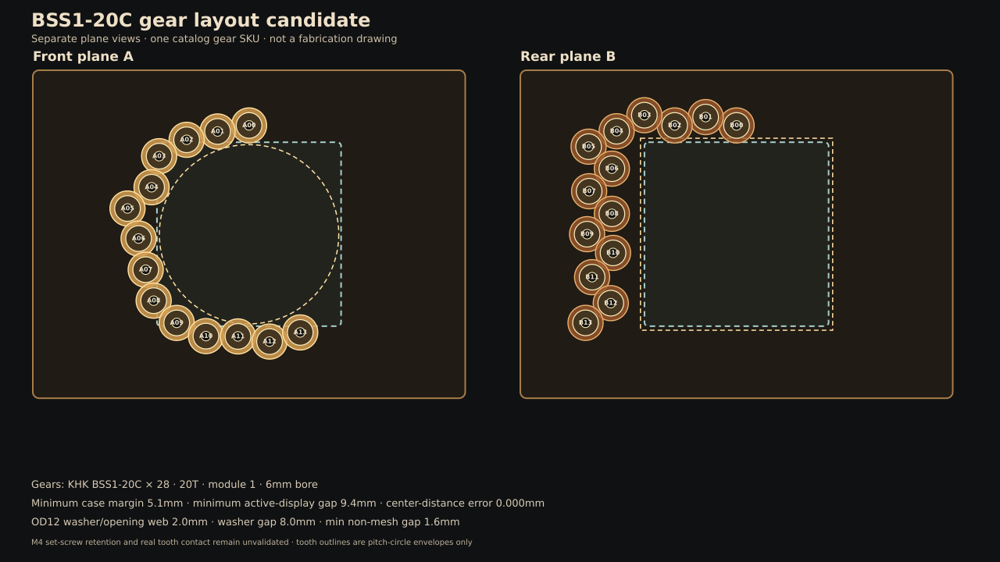

# BSS1-20C・6mm軸支持候補 — 2026-10-22

状態：**PROVISIONAL。購入前の具体候補。全量購入・製作図・組立合格ではない。**

**2026-10-22優先順位更新：** ユーザー方針により、初号機の完成を優先します。本書の専用保持治具・圧入クーポン・木溝クーポンは必須ゲートではなく、予備確認案として扱います。次の成果物は一台分の統合図面/BOMです。組立後の目視・手回し・電流制限した低速運転で、割れ、歯車滑り、噛み込み、配線干渉を確認し、異常時だけ個別の修正試験へ戻ります。未検証を合格扱いにはしません。

目的は、単一の静音モーターで装飾歯車列を動かす新設計について、同じ型番を中心に少量試験できる購入候補、軸受け、軸方向スタック、数量を一つに揃えることです。7軸設計は参照していません。28歯車は既存レイアウトからの計算例で、要求数ではありません。

現物は未組立です。この文書の型番/価格表は購入判断用の候補で、発注済みまたは在庫確認済みを意味しません。現物を組めば完成、という状態にはまだ達していません。特にモーター配線、支持板の圧入/溝、表示ガラスと軸のすき間、電装全体の配置を設計/検証してから全量BOMを発行します。

Waveshare公式Drawingを机上確認し、表示モジュールの円形外径Ø115mm、LCD有効径Ø87.60mm、PDF厚15.10mm/STEP包絡15.50mm、外周4×M4×4.00表記と穴中心X=±37.50/Y=±39.25mmを反映しました。外周穴ピッチは75×78.5mmです。前回記載の75×75mmは内部PCBねじ位置との混同で誤りです。M4×4.00はM4タップ・深さ4.00mmと解釈しますが、購入個体で照合します。旧「M3スペーサーで基板を直接支持板へ止める」案は撤回し、現候補はM4基板穴/M3支持板アンカーの4本腕キャリアです。[表示基板インターフェース](display-board-interface.md)を参照。

## 現在の候補

全位置をKHK **BSS1-20C**、20歯・モジュール1に揃えます。公開寸法は、歯先円径22mm、歯幅6mm、6mm AH7穴、ボス径16mm・長さ8mm、全長14mmです。KHKカタログではタップ穴付き製品に止めねじが付属し、型番表上このねじはM4×4です。追加の止めねじは購入しません。受領時に付属数とねじ寸法を照合します。[KHK BSS寸法表](https://khkgears.net/pdf/bss.pdf)・[KHK 2025カタログ](https://www.khkgears.co.jp/files/libs/4530/202509091326491899.pdf)・[MISUMIの付属ねじ表](https://jp.misumi-ec.com/vona2/detail/221004936940/)・[MonotaROの型番/寸法/価格表示](https://www.monotaro.com/p/8339/7215/)。小原歯車工業の資料では快削黄銅C3604、圧力角20°です。

外径の違う歯車を混ぜる外観候補ではなく、**1種類の在庫品で寸法間違いを減らす機械試験候補**です。全28個をこの型番にした見積は歯車だけで税込表示¥52,304となります。価格と出荷表示は2026-10-22の確認値で、購入時に再確認が必要です。

### 残る機械リスクと初号機での確認

1. BSS1-20CのM4止めねじは候補部品として選定済みですが、保持力は未測定です。KHKは確実な固定にキーまたはノックピンの併用を案内しています。[KHK歯車Q&A](https://www.khkgears.co.jp/gear_technology/faq/)。初号機では専用治具を作らず、軸/歯車に合いマークを付けて手回し・電流制限低速運転を行います。マークがずれたら運転を止め、継続前に固定方法を改善します。モーターの公開保持トルクは20mN·m/相です。[Adafruit #4411](https://www.adafruit.com/product/4411)。
2. OILES 80B-0608は呼び寸法ID6・OD8・長さ8mmです。推奨軸は6mm h7（5.988〜6.000mm）、ハウジング穴は8mm H7（8.000〜8.015mm）。カタログ上のブッシュODは8.045〜8.157mmで、穴との公称しめしろは0.030〜0.157mmです。ブッシュIDの+0.045〜+0.095mm公差は所定のリングゲージへ圧入した後の値です。初号機は最終支持板へ直接取り付け、最初の圧入箇所で割れ/白化/移動と軸の回転抵抗を確認します。異常時は組立を止め、支持板材か保持方法を見直します。[OILES #80カタログ](https://www.oilesglobal.com/en/files/bearing34.pdf)・[OILES取付要領](https://www.oiles.co.jp/en/products/bearing/manual/exchange/)・[販売寸法](https://www.monotaro.com/p/0045/9313/)。
3. 前後支持板材はAS ONE 68-7869-18（透明PC、300×450×8mm）を評価用1枚として選定しました。受領時に材質表示/板厚/反りを記録し、その1枚から圧入クーポンと4歯車板を先に切り出します。**別体クーポンのPASSは初号機の条件にしません。** 支持板は最終配置図で加工し、組立時に最初のブッシュを入れた箇所の割れ/移動を確認します。異常時は全組立を止め、支持方法を見直します。販売元へ端材/未掲載公差を問い合わせる必要はありません。PCで割れ/変形が出た場合は金属板などへ変更し、再度穴仕様を検証します。
4. 真鍮歯車の実歯当たり、金属歯車列の音、全28位置の組立、軸/継手の振れは未確認です。静音性・製品完成を意味しません。
5. NEMA-8 #4411とTMC2209 #6121の型番は選定済みです。#4411はメーカー記載約406mmの4芯リード線で、線色は個体差があり、線径は公開されていません。#6121端子の公称範囲は26–20AWGなので、短いAWG22 UL1007線へ個別にはんだ接続する方法を選びました（直接端子保持が安定する場合は直接接続も可）。#6121外形を背面着脱カバー内側の候補位置へCAD反映済みです。[接続/配線案](../04-electronics/motor-harness-interface.md)・[NEMA-8 #4411](https://www.adafruit.com/product/4411)・[TMC2209 #6121](https://www.adafruit.com/product/6121)。実際の線出口、後壁7mmの逃げ、線固定、歯車/軸との離隔、背面開閉は現物受入に残ります。

## 28位置の机上レイアウト

入力は現行mainの歯車位置表です。隣接中心距離をすべて20mmへ再配置し、B04–B06の非隣接干渉を避けるためB06方向を4°補正しました。公称円包絡の2D計算では次の値です。

| 指標 | 結果 |
|---|---:|
| 歯車/支持軸 | 28個 / 27軸（A00・B00の共通軸1本） |
| 歯車型番 | BSS1-20C ×28 |
| 最小ケース内余裕 | 5.10mm |
| LCD有効円Ø87.60mmへの最小平面すき間 | 9.40mm |
| 外周レンズØ112.60mmに対するB00の2D半径方向すき間 | 0.70mm |
| 3.4C外周Ø115.00mmに対するB00の2D半径方向重なり | 0.50mm |
| 支持穴と開口の最小ウェブ | 4.00mm |
| POMワッシャーと開口の最小ウェブ | 2.00mm |
| 同一平面の非隣接歯車間最小すき間 | 1.59mm |
| 中心距離の数値誤差 | 0.001mm未満 |

既存の9.40mm値はLCD有効径Ø87.60mmまでの平面距離で、ガラス外周の干渉余裕ではありません。B00歯車先端はガラス外周との平面投影で0.70mm、モジュール外周Ø115mmとは0.50mm重なる計算です。表示ガラス面をz=44.50mm候補へ動かし、B歯面終端z=39mmから5.50mmの名目軸方向すき間を確保しました。B歯車の軸方向振れ、支持板たわみ、ガラス/モジュール実寸を含む最小距離はまだ受入れていません。

再現用ファイル：[生成スクリプト](generate_bss20_axis_candidate.py)、[全28位置とZ座標CSV](gear_axis_schedule_bss20_candidate.csv)、[前支持板の穴配置](gear_support_plate_A_bss20_candidate.svg)、[後支持板の穴配置](gear_support_plate_B_bss20_candidate.svg)。これらは加工用CAMデータではありません。CAD出力の座標小数桁は加工公差の指示ではなく、噛み合う軸間距離にだけKHK推奨のH8プラス側（BSSは切削歯車）を適用し、ケース外形などへ一律の高精度公差を付けません。[KHK組立精度](https://www.khkgears.co.jp/files/libs/3046/202508062248126215.pdf)・[中心距離精度](https://www.khkgears.co.jp/gear_technology/gear_reference/khk482_1/)

支持板候補は252×187×8mmを前後各1枚、14穴ずつです。プレート原点はケース外側の左上から(9,9)mm、CSVの`plate_x_mm`/`plate_y_mm`が各穴中心です。A面の中央開口はØ112mm、B面の中央開口は120×120mmです。透明PC 8mmは材料候補に留めます。外形270×205mm・壁厚12mmに対し、板端は各壁へ3mm入るため、捕捉溝は奥行Z方向幅9.0mm・壁内側から深さ4.0mmを候補とします。8mm公称板との幅差は実測し、0.25/0.5mm PETシムでがたを抑えます。厳密な板厚合わせは木工加工へ要求しません。同材/同厚の20×20×8mm PC試験片にØ8 H7穴を1個加工してブッシュを圧入します。さらに実際の側壁材から9×4mm溝試験片を取り、支持板の挿入/保持を確認します。初号機では独立した圧入片/溝片を作らず、実部品を使って板と溝を仮合わせします。割れ、がた、抜けがあれば作業を止めて加工寸法または保持方法を直します。

[BSS20包絡モデル](bss20_clock_envelope_review.scad)は支持板、歯車、ワッシャー、カラー、表示モジュールのØ115×15.50mm保守包絡、ケース溝、モーター、3mm PC四本腕の表示キャリア候補を一つのZ基準で表示します。表示ガラス前面z=44.50mm候補とし、B歯面終端z=39mmから5.50mmの名目軸方向すき間を置きました。キャリア形状は机上候補で、ねじ頭、背面PCB実装部品/端子、ケーブルと挿抜包絡、キャリアのたわみは未受入です。モーター後壁余裕7mmもリード線/曲げ空間の成立を示しません。モデルの歯形/公差/配線は簡略化しており、CAMや製造図ではありません。

## 4歯車パイロット

最初はA00〜A03だけを一枚の板で確認します。板左上を(0,0)として穴位置を示します。隣接中心距離は全て20.000mmです。

| ID | 部品 | XY (mm) | 次軸まで |
|---|---|---:|---:|
| A00 | BSS1-20C | 80.000, 17.825 | 20.000mm |
| A01 | BSS1-20C | 60.349, 21.546 | 20.000mm |
| A02 | BSS1-20C | 41.047, 26.782 | 20.000mm |
| A03 | BSS1-20C | 23.876, 37.037 | — |

試験板の候補は100×56×8mm、ブッシュ穴Ø8 H7×4です。この4穴配置は任意のパイロット例です。初号機では最終選定した歯車数/配置を一台分支持板へ直接反映します。[パイロット配置図](four_gear_bss20_pilot.svg)は位置確認用で、CAMデータではありません。

### 1軸適合確認用の先行キット

4個を買う前に、まず以下の最小構成で型番と嵌合を照合します。

| 品目 | 注文単位 | 使う数 | 2026-10-22表示価格 |
|---|---:|---:|---:|
| [KHK BSS1-20C](https://www.monotaro.com/p/8339/7215/) | 1個（M4×4止めねじ1本付属） | 1 | ¥1,868 |
| [大阪魂 6×30 SUS303 B種h7平行ピン](https://www.monotaro.com/p/4215/6807/) | 3個/袋 | 1 | ¥493 |
| [OILES 80B-0608](https://www.monotaro.com/p/0045/9313/) | 1個 | 1 | ¥51 |
| [KANA KSC0605](https://www.monotaro.com/p/1029/5117/) | 1個 | 1 | ¥208 |
| [廣杉計器 0612-10 POMワッシャー](https://www.monotaro.com/p/4213/5143/) | 12個/袋 | 2 | ¥615 |
| **市販部品小計** |  |  | **¥3,235** |

6×30ピンは3本入り1袋を購入して1本を使い、2本を予備にします。ワッシャーは12枚入り1袋を購入して2枚を使い、10枚を次段階/予備に回します。KSC0605は内径6・外径12・幅5mm、0612-10は内径6.3・外径12・厚さ1mmです。価格、注文コード、寸法は販売店表示のスナップショットです。BSS1-20Cは5日以内出荷表示・返品不可のため、注文直前に型番と仕様をもう一度照合します。[ピン](https://www.monotaro.com/p/4215/6807/)・[カラー](https://www.monotaro.com/p/1029/5117/)・[ワッシャー](https://www.monotaro.com/p/4213/5143/)。

この小計には、**同一材の圧入試験片、100×56×8mm試験板、側壁溝試験片、加工/送料、重り、歯車ボスを台へ固定するブロック、軸側レバーアダプターを含みません**。3種類の試験片の寸法と材料条件を[加工見積図 v0.1 (PDF)](bss20_support_coupon_quote_v0.1.pdf)にまとめました。治具の原理図と寸法案は[4歯車試験票](four-gear-manual-test.md)および[治具配置図](holding_test_fixture_concept.svg)に記録しました。歯車固定具はボスØ16×8mmとM4止めねじ逃げ、軸側アダプターはピンの10mm以上の把持、レバーは軸中心から73〜77mmの吊り位置を条件とします。材料/加工法の見積と実物の治具滑り確認は残ります。これは発注指示ではありません。

1軸確認が合格した後に残り3組を追加する場合は、BSS1-20C×3、6×30ピン3本入り×1袋、80B-0608×3、KSC0605×3です。追加市販部品は税込表示¥6,874、4軸分の市販部品総額は¥10,109です。初回のワッシャー1袋12枚で8枚を使い、4枚が残ります。ピンは2袋計6本から4本を使い、2本が残ります。

### 1軸と4歯車の合格条件

- 歯車穴6 AH7と6mm h7ピンの受入寸法を記録し、付属M4止めねじのサイズを確認する。
- 歯車ボスを試験台に固定し、軸側レバーへ95〜105gを73〜77mmで掛けて両方向約0.070N·mを各10秒、3回加える。歯車/軸/治具の合いマークが動かないことを記録し、指の感触だけでPASSにしない。
- 圧入試験片は割れ/白化なし、圧入後のブッシュ内径でピンが引っ掛からず回ること。圧入力と内径を記録する。
- 4歯車を正逆10回転ずつ手回しし、歯飛び、噛み込み、支持板/ワッシャーとの擦れ、ブッシュの移動がないこと。
- 組立後に全列を手回し/低速運転し、歯飛び、滑り、噛み込み、板割れがないことを確認する。28位置は現時点で数量要求ではありません。

## 軸方向スタック候補

Z=0は前面ガード内面、後壁はz=121mmです。BSS1-20Cの全長14mm＝ボス8mm+歯面6mmに合わせています。

| 部位 | Z範囲 (mm) |
|---|---:|
| 前ガード候補 | -3…0 |
| A単軸カラー / カラー側POMワッシャー | 1…6 / 6…7 |
| A支持板 / ギア側POMワッシャー | 7…15 / 15…16 |
| Aギアのボス / 歯面 | 16…24 / 24…30 |
| A/B歯面間すき間 | 30…33 |
| Bギアの歯面 / ボス | 33…39 / 39…47 |
| Bギア側POMワッシャー / 支持板 | 47…48 / 48…56 |
| Bカラー側POMワッシャー / カラー | 56…57 / 57…62 |
| A単軸 / B単軸 | 1…31 / 33…63（6×30mm） |
| A00/B00共通軸 | 4…64（6×60mm） |
| NBK MJT-14-RD-4-6候補 | 57…79（6mm側7mm挿入） |
| モーター取付面 / 本体後端 | 81 / 114（後壁まで7mm） |

6×60mm SUS303 B種h7ピンは2本入りの現行販売品で、1本使用します。[MonotaRO品番M6×60](https://www.monotaro.com/p/4294/2453/)。継手候補は4mmモーター軸↔6mm共通軸、外径14mm、全長22mmです。[NBK仕様](https://www.nbk1560.com/products/coupling/couplicon/jaw_type/MJT-RD/)。表示基板、配線、モーター実寸、軸振れ、ケースの加工余裕はまだ重ね合わせていません。

## 28位置へ拡張する場合の市販部品数

| 部品 | 数量/買い方 | 現在の参考小計 |
|---|---:|---:|
| BSS1-20C | 28個 | ¥52,304 |
| 6×30mm SUS303 B種h7ピン | 26本使用、3本袋×9（27本） | ¥4,437 |
| 6×60mm SUS303 B種h7ピン | 1本使用、2本袋×1 | ¥934 |
| OILES 80B-0608 | 28個 | ¥1,428 |
| KSC0605 | 26個 | ¥5,408 |
| POM 0612-10 | 54枚使用、12枚袋×5（60枚） | ¥3,075 |
| NBK MJT-14-RD-4-6 | 1個 | ¥2,167参考 |
| **市販駆動部品合計** |  | **¥69,753参考** |

金額には支持板と試験片の加工費、PC板、ギア/軸の実測不適合時の変更分、モーター/ドライバー/ケース/電源、送料を含みません。全量を今買う段階ではありません。

数量の内訳は、28歯車を26本の単軸と1本のA00/B00共通軸（2歯車）に載せる構成です。単軸26本はカラー各1個とワッシャー各2枚、共通軸はギア側ワッシャー2枚を使います。共通軸の軸方向保持はNBK継手で受ける仮定のため、継手の固定/位置決め確認がPASSするまで全量数量を確定扱いにしません。合計はカラー26個、ワッシャー54枚です（28枚はギア側、26枚はカラー側）。

## 判定

**完成機用の全量発注・製作リリースには達していません。** 1軸キットは型番/販売単位を特定した現物照合用サンプルです。買う場合も、BSS1-20Cが返品不可表示である点を踏まえ、販売条件を注文直前に確認し、1組だけに限ります。これは組立適合済みや購入必須を意味しません。

「部品を買ってすぐ1軸試験まで完了できる」注文にするには、先に同じ材料のPC圧入片、側壁溝片の材料/寸法/加工見積、歯車固定ブロックと軸レバーの簡易図を揃えます。これらは市販部品キットに含まれず、まだ発注仕様として確定していません。現物未入手のユーザーに今してもらう操作はありません。
