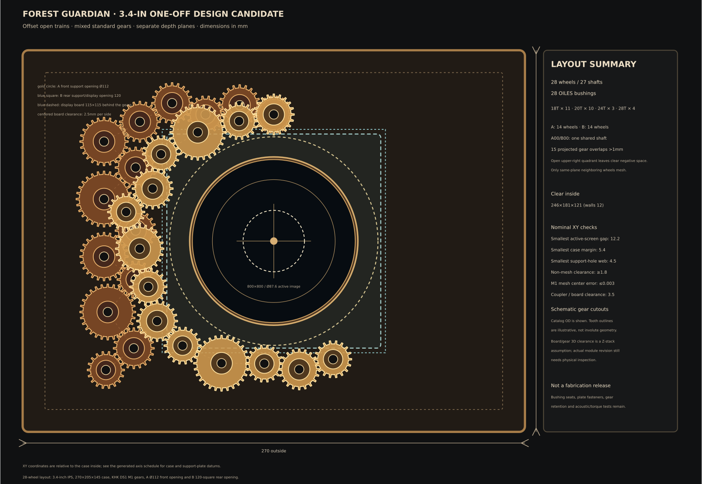

# 一台用時計・3D包絡レビュー

更新日：2026-10-21

状態：**CSV座標と公称寸法から生成した配置レビュー模型。製造図・実機受入ではない。**



## この模型で見られるもの

- 外形270×205×145mm、内寸246×181×121mmの木箱内で、前後支持板、3.4インチ表示器、二層28歯車、1モーターの名目位置関係を一つの3D画面で確認できる。
- 14個ずつの歯車中心は[`gear_axis_schedule.csv`](gear_axis_schedule.csv)から読み込み、[`generate_clock_envelope_review.py`](generate_clock_envelope_review.py)がOpenSCADデータを生成する。座標の原本は歯車軸表。
- 表示基板は115×115mmの正方形包絡、前面の円形表示は87.6mm。背面板の実厚/端子/穴/ケーブルは未測定のため、3D模型上の基板奥行15mmは見た目用の仮値。
- 軸継手は外径20mm案だとA00/B00軸から基板公称外形まで0.5mmしか空かないため、4mm↔5mm穴の既製品NBK MJT-14-RD-4-5（外径14mm/全長22mm/ハブL=7mm）へ変更した。軸位置は維持し、名目平面すき間は3.5mm。軸端・基板上部品・USB/microSD端子の実寸は含まない。
- 軸方向スタックは、共通軸端z=55、継手z=48–70（両側7mm挿入）、NEMA-8取付面z=72/本体後端z=105、ケース背面内面z=121。モーター後方は名目16mm。モーター面と継手の間に2mmを残し、約9mm突出軸の挿入量を7mmに制限する。
- 歯車の外径と歯数はM1の公称値に合わせた模式形状。インボリュート歯形、ハブ外径、歯車穴の公差は再現していない。ハブは直径10mmの表示用仮形状。
- 木箱は内部を見せるため前面中央と背面を開けている。曲線のウォールナット枠、化粧窓、背面コネクター、取付穴、LED、配線は描いていない。

## 再生成

リポジトリのルートから実行する。OpenSCADのGUIでSCADを開くと3D配置を回転して確認できる。

```sh
python3 docs/03-mechanical/generate_clock_envelope_review.py
openscad -o /tmp/cots_clock_envelope_review.csg docs/03-mechanical/cots_clock_envelope_review.scad
```

最後のコマンドはOpenSCADデータの構文確認用。画像出力はX/OpenGLが使える環境で行う。この作業環境ではヘッドレス画像出力ができないため、正面図は既存の配置プレビューを使う。

この模型で判断するのは公称部品の収まりと立体配置まで。歯当たり、板の強度、ブッシュ圧入、表示基板の実厚/端子/改版、モーター音/温度、ガードの指到達防止、仕上がり外観は現物確認が必要。
