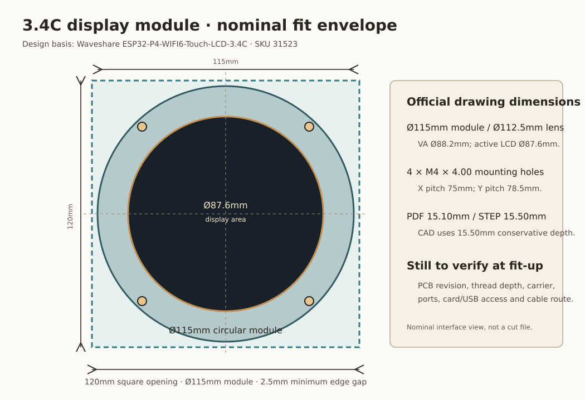
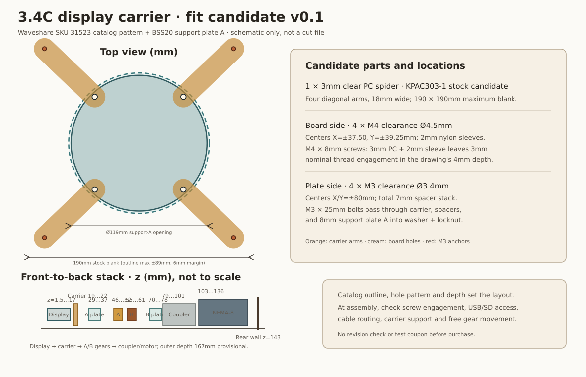

# 3.4C表示基板の寸法インターフェース

更新日：2026-10-22

状態：**Waveshare公開2D/3D資料を設計基準としてSKU31523と公称寸法を選定済み。キャリアは通常の逃げ穴で調整可能にする。現物確認は受領後・最終加工前の受入項目で、サンプル選定/購入の阻害事項ではない。**

## 設計に使う公称値

Waveshare ESP32-P4-WIFI6-Touch-LCD-3.4C（SKU 31523）の公式Drawing ZIPを2026-10-22に取得し、PDF/DXF/STEPを確認した。前面外形は円形Ø115.00mmで、`115×115mm`は円形モジュールの最大矩形包絡である。PDFはガラス厚6.00mm、全厚15.10mmを示し、公式STEPの全体包絡は115×115×15.50mmでPDFより0.40mm深い。机上包絡モデルでは15.50mmを使う。

取付図の外周4点は`4-M4×4.00`表記で、図面解釈は**M4タップ穴・ねじ深さ4.00mm**。中心は基板中央からX=±37.50mm、Y=±39.25mm、ピッチ75.00×78.50mmである。前回の「75×75mm」は内部基板固定ねじ列と混同した誤読なので撤回する。設計基準はこの公開Drawing/STEPとし、SKU31523の選定は完了とする。公開参照回路図rev1.1と購入個体の改版差は、受領時にシルクを記録する通常の受入項目であり、注文前に販売元へ照会する条件にはしない。ねじ穴位置は公開値を使い、キャリアのØ4.5mm逃げ穴で小さな位置差を吸収する。大きな不一致があればキャリア側だけを調整し、表示器SKUを変える判断は別途行う。

| 基準 | 寸法 | この設計での使い方 |
|---|---:|---|
| 前面パネル外形 | Ø115.00mm | 115×115mmの保守的な最大矩形包絡で支持板開口との干渉を確認 |
| ガラス外径 | Ø112.50mm +0.10mm | 透明支持板の開口/遮蔽と外観を照合 |
| レンズ視野 | Ø88.20mm ±0.20mm | 視認開口と文字盤の配置確認 |
| LCD有効領域 | Ø87.60mm | 800×800有効画面の直径 |
| ガラス厚 | 6.00mm | 外装前面からモジュール内部への段差確認 |
| 全厚 | PDF 15.10mm / STEP包絡15.50mm | 差0.40mm。机上モデルは15.50mmを使用し、現物受入で確定 |
| 外周取付穴 | 図面表記`4-M4×4.00` | M4タップ・深さ4.00mmと解釈。個体受入で照合 |
| 外周取付穴ピッチ | X=±37.50mm、Y=±39.25mm | 中心間75.00×78.50mm。内部PCBねじ位置とは別 |
| 前面支持板Aの開口 | Ø119mm | Ø115mm円形モジュールを支持板Aより前に配置するための通過開口 |
| 基板包絡と開口の差 | 円形Ø115mmをØ119mm穴へ通す | 半径方向2mmの公称余裕。開口外のA支持板へ4本腕キャリアを固定 |
| 画面ガラス面 | z=1.50mm候補 | 前ガード内面z=0から1.5mm後方 |
| 基板奥行包絡 | z=1.50…17.00mm | STEP最大深さ15.50mm。支持板Aはz=29…37mm、歯車はさらに後方 |

Ø119mm開口は円形Ø115mmモジュールを通すための公称逃げです。外周M4穴から開口外へ荷重を渡すキャリアを設け、4つのM3アンカーを支持板Aへ固定します。図面値から下記の4本腕キャリア候補をCADに追加しました。基板個体の版照合は購入条件にせず、完成品の組立時にねじ掛かり、ポート操作、ケーブル取り回しを通常確認します。

## 取付キャリア候補 v0

キャリアは、選定済みの透明PC材 KPAC303-1（厚さ3mm）から作る一体の4本腕部品とする。表示器は前面側、支持板Aと歯車列は背面側へ置く。キャリアは支持板Aの前側へ立てた4本のスペーサで支え、開口外4隅のM3貫通ねじで固定する。現行CADの候補形状は[包絡モデル](bss20_clock_envelope_review.scad)に反映した。

| 部位 | 候補仕様 | 図面上の理由/状態 |
|---|---|---|
| 材料 | 透明PC 3mm、KPAC303-1の余材候補 | 製品ガード用に選定済みの評価材と同じ。ガードを270×205mmで取る場合でも190×190mmのキャリア素材は300×450mm板に収まる机上配置。実輪郭/切りしろはまだ未確定 |
| 基板側腕 | 4本、幅18mm、M4クリアランス穴Ø4.5mm。中心X=±37.50、Y=±39.25mm | 公開穴パターンを基準にした通常の逃げ穴。厳密なはめ合い公差は設けない |
| 支持板側アンカー | X/Y=±80mm、穴Ø3.4mm。腕の外形は中心±89mm以内 | Ø119mm開口の外側に配置。190mm角素材に6mmの縁余白を残す。支持板Aの角へ4点固定 |
| 支持板側スペーサ | 4か所、合計7mm、外径6mm・M3通し穴相当 | キャリア後面z=22mmから支持板A前面z=29mmまで。市販6mmスペーサ+1mm座金の組合せ候補 |
| 基板側スペーサ | 4個、厚さ2mm、M4用絶縁スペーサ候補 | 基板後面z=17mmからキャリア下面z=19mmまで |
| 基板締結 | M4×8mm pan-head候補 | 3mmキャリア+2mmスペーサ後の公称ねじ掛かり3mm。図面のM4×4表記を基準にする |
| 支持板締結 | M3×25mm貫通ねじ4本、平座金/ゆるみ止めナット | 8mm支持板+7mmスペーサ+3mmキャリアを通す候補。締結は過度に締めず、樹脂板を割らない |

18mm腕は各M4座から斜め外側の開口角へ伸び、基板中央は覆いません。キャリアは基板包絡後端z=17mmから2mm離れたz=19mmに始まり、z=22mmで終わります。支持板Aはz=29…37mmなので、キャリアと支持板間に7mmのスペーサを置けます。画面/歯車間は前後方向に十分離れますが、回転時の接触・支持板のたわみは組立後に確認します。

この案でCAD上の保持方式と支持点は具体化した。完成機用の数量/加工BOMは全体統合後に確定するが、公開寸法を使った1台分のキャリア候補まで選定済みである。受領個体との小さな差はキャリアの逃げ穴/腕幅で吸収し、支持板Aの歯車穴/軸位置は変更しない。

## キャリア締結具の寸法候補

以下の規格寸法で一式にします。ねじ長さはスタックから算出済みですが、表示基板のM4ねじ深さ解釈、取付座面、キャリアたわみを現物確認するまで購入指示/製作指示ではありません。

| 用途 | 選定寸法 | 数量 | 寸法の根拠 |
|---|---|---:|---|
| 基板M4ねじ | SUS304/A2、M4×8mm、なべ頭・十字穴（JIS B 1111相当） | 4 | PCキャリア3mm + 絶縁スペーサ2mm = 5mm。基板側へ3mm掛かり、図面解釈上の深さ4mmに1mm余裕 |
| 基板側絶縁スペーサ | POM、ID4.3×OD8×長さ2mm | 4 | M4軸周囲を絶縁し、公開STEPの基板背面包絡とキャリア下面を2mm離す |
| 支持板側通しねじ | SUS304/A2、M3×25mm、なべ頭・十字穴（JIS B 1111相当） | 4 | 8mm支持板A + 7mmスペーサ + 3mmキャリアを通す候補 |
| 支持板側スペーサ | POM、ID3.2×OD6×長さ6mm + 1mm平座金 | 4組 | 支持板A前面z=29mmからキャリア後面z=22mmまで |
| 平座金 | SUS304/A2、M3用、ID3.2×OD9×厚0.8mm（DIN 9021相当） | 8 | 支持板A裏面とキャリア上面を両側から広く押さえる。18mm腕幅に収まる |
| ゆるみ止めナット | SUS304/A2、M3ナイロンインサート六角ナット（DIN 985相当） | 4 | キャリア上面側の通しねじを緩みにくくする |

M4基板ねじはキャリアに座る頭部で押さえるため、別座金を追加しません。追加すると有効掛かりを減らすため、別部品へ置換しないでください。M3×25mmは頭下長さです。手締めでPCへ過大な圧力を掛けないようにし、規格/メーカーから指定のない締付トルクは作りません。M4ねじ底付き、実ねじ掛かり、M3座金の端余裕、キャリアたわみはD2-1で確認します。

## 寸法の算術確認

- 前面支持板A開口の半径方向すき間：`(119 − 115) / 2 = 2.0mm`。
- 前面開口と表示領域の半径方向差：`(112 − 87.6) / 2 = 12.2mm`。
- ケース内面246×181mmへ最大矩形包絡を中央配置したときの余白：左右各65.5mm、上下各33mm。
- ガラス前面z=1.50mm、15.50mm奥行包絡はz=1.50…17.00mm。支持板Aはz=29…37mmのØ119mm開口で周囲を保持する。
- 表示器後端z=17mmから最前側軸カラー開始z=23mmまで6mm。キャリア後端z=22mmから軸カラーまで1mm。いずれもCAD名目値で、振れ/板たわみは含まない。

机上設計で閉じた値は、外径/表示径、外周M4穴の75×78.5mmパターン、公開図面のM4×4表記、15.50mmの保守的な深さ包絡、前側キャリアの4点接続候補である。表示面をz=1.50mmへ置き、画面→歯車→モーターの順に並べました。個体リビジョン確認は購入条件ではありません。コネクター操作、配線固定、キャリア/支持板のたわみは組立時の通常確認とし、問題が出た箇所だけ調整します。

## 設計と実物受入の分離

1. **机上配置**：公式図面の円形外形、ガラス、外周M4穴パターンを使い、ガラス面z=1.50mm、基板後端z=17.00mmでモデル化する。
2. **組立時の通常確認**：4点固定、ねじの掛かり、USB/microSD操作、ケーブル曲げ、画面前面の座り、歯車との接触を確認する。小さな差はキャリアの逃げ穴/腕やスペーサで調整する。
3. **購入前のブロッカー**：個体リビジョン照合や独立試験片は置かない。公開カタログ仕様に基づくSKU選定済みである。

この文書は一台用の設計基準であり、加工承認、発注承認、通電許可を意味しない。

## 図

[元のSVG図](display_board_envelope.svg)

この配置図は候補寸法の説明用で、加工データではない。

出典：[Waveshare 3.4C製品ページ](https://www.waveshare.com/esp32-p4-wifi6-touch-lcd-3.4c.htm?sku=31523)、[公式ドキュメント](https://docs.waveshare.com/ESP32-P4-WIFI6-Touch-LCD-XC)、[公式3.4C Drawing ZIP](https://files.waveshare.com/wiki/ESP32-P4-WIFI6-Touch-LCD-XC/ESP32-P4-WIFI6-TOUCH-LCD-3_4C.zip)、[Waveshare管理の回路図rev1.1参照](https://github.com/waveshareteam/ESP32-P4-WIFI6-Touch-LCD-XC/blob/main/docs/HARDWARE.md)。Drawing ZIPの2026-10-22取得SHA-256: `e98cb43946f658f95ad6c238f19f137c604cebcc0dcb715fde9e0a0670adb5da`。PDFは15.10mm、STEP全体包絡はCadQuery 2.7.0で115×115×15.50mmを確認。公開CADは設計参照で、入手個体の改版保証ではない。
