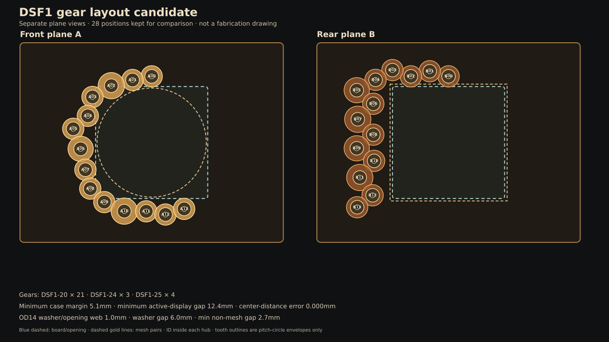

# DSF歯車・軸支持 再配置候補 — 2026-10-21

状態：**机上の再配置候補。購入図面・加工指示・組立合格ではない。**

> **履歴資料。2026-10-22に現行機械候補をBSS1-20C・6mm軸・MJT-14-RD-4-6へ更新済みです。** このDSF1・5mm軸・MJT-14-RD-4-5案を購入や加工に使わず、[現行BSS1-20C候補](bss20_axis_support_candidate-2026-10-22.md)を参照してください。

現行DS1/CADに見つかった軸支持と歯車固定の不整合を解くための候補を1案にまとめます。実物購入へ進む前の比較基準として扱います。28個はこの再配置の比較用個数にすぎず、要求ではありません。

## 当時の採用候補（履歴）

KHK DSF1 F-LocのM1歯車に置き換えます。2025年KHKカタログのM1型番は20/24/25/30/32/36/40/50/60/80/100Tで、今回の候補ではDSF1-20、DSF1-24、DSF1-25を使います。これらは5mm穴、幅6mmの歯面、幅8mmのSUS303締結ハブ、全長14mm、ハブ外径14mmです。メーカー指定は軸公差g6/h6/h7です。締結は摩擦結合のため滑りトルクを照合し、軸を差さずに締付けないよう注意があります。[KHK 2025 Spur Gears Catalog](https://khkgears.net/pdf/2025/spur-gears.pdf) p.60。

5mm h7軸をOILES 80B-0508の5mm内径ブッシュに通し、DSFハブをピンへ締結します。単軸ごとに対応する支持板1枚で支持し、板の反対側にある別平面まで軸を伸ばしません。軸を板の両側から捕捉するため、軸カラー、支持板、両側のPOMスラストワッシャー、ギアの順をZ断面へ明記しました。

## 平面配置候補

現行28軸配置の隣接中心線方向を残し、使えるDSF歯数に合わせて各中心距離を再計算しました。

| 項目 | 計算結果 |
|---|---:|
| DSF1-20 / DSF1-24 / DSF1-25 | 21 / 3 / 4個 |
| 1平面内の最小歯車中心距離誤差 | 0.000mm未満（倍精度計算誤差） |
| 非隣接歯車間の最小外径すき間 | 2.69mm |
| ケース内周との最小余裕 | 5.10mm |
| 有効表示領域Ø87.6との最小平面距離 | 12.42mm |
| 支持穴と表示開口の最小ウェブ | 4.50mm（ブッシュOD7基準） |
| OD14スラストワッシャーと表示開口の最小余裕 | 1.00mm |
| 同じ平面のワッシャー間最小距離 | 6.00mm |

この表は公称ピッチ円・外径円の2D計算です。実歯形、歯当たり、軸振れ、加工誤差、板のたわみ、工具アクセスを含みません。再現用の[候補生成スクリプト](generate_dsf_axis_candidate.py)、[軸・Z座標CSV](gear_axis_schedule_dsf_candidate.csv)、[配置SVG](irregular_layered_gear_layout_dsf_candidate.svg)があります。

## 軸方向スタック候補

Z=0は前面ガードの内側面。外形は幅270×高さ205×奥行145mm候補、ケース内の後壁はz=121mmとします。

| 部品/区間 | Z位置 | 機能 |
|---|---:|---|
| 前面ガード | -3…0mm | 3mm板候補 |
| A単軸カラー | 1…6mm | KSC0505候補。前面ガードと1mm離す |
| Aカラー側ワッシャー | 6…7mm | POM、IDは軸に対しすきま、OD14×1mm候補 |
| A前支持板 | 7…15mm | 8mm板、OILES 80B-0508を圧入する候補 |
| Aギア側ワッシャー | 15…16mm | ハブと支持板間のスラスト面 |
| Aギア | ハブ16…24mm、歯面24…30mm | ハブを前支持板へ向ける |
| A/B歯面間 | 30…33mm | 公称3mmすき間 |
| Bギア | 歯面33…39mm、ハブ39…47mm | Aを裏返した向き |
| Bギア側ワッシャー | 47…48mm | ハブと支持板間のスラスト面 |
| B後支持板 | 48…56mm | 8mm板、OILES 80B-0508を圧入する候補 |
| Bカラー側ワッシャー | 56…57mm | POM、OD14×1mm候補 |
| B単軸カラー | 57…62mm | KSC0505候補 |
| 駆動継手 | 57…79mm | NBK MJT-14-RD-4-5候補。5mm軸を7mm挿入 |
| NEMA-8取付面/本体後端 | 81 / 114mm | 後壁z=121まで公称7mm |
| 3.4C表示面の仮データ | z=48mm | B歯面の後ろ9mm。実基板包絡未測定 |

単軸はA= z1…31mm、B=z33…63mmの5×30mm h7平行ピン候補です。A側カラーの外に約1mm、B側カラーの後ろに約1mm軸端が残ります。共通軸はz4…64mmの5×60mm h7平行ピン候補で、前後のブッシュ、A00/B00のDSFハブ2個、継手へ通します。モーター後端の7mmすき間と基板奥行きは物理受入が必要です。

単軸の保持方向は、カラーが外側へ抜ける移動を止め、ギアハブが内側へ移動する分をワッシャーと支持板で止めます。ワッシャーは歯面ごとに1枚、単軸カラーごとに1枚です。数量候補は歯車側28枚 + 単軸カラー側26枚 = 54枚で、実際の内径・厚み・擦れ面は試験片で決めます。

## まず試す4歯車

少量試験にはA00〜A03を使います。中心座標は100×56mm治具板の左上からの値です。

| ID | 歯車 | 歯数 | X,Y (mm) | 次軸まで |
|---|---|---:|---:|---:|
| A00 | DSF1-20 | 20T | 80.000, 17.825 | 20.000mm |
| A01 | DSF1-20 | 20T | 60.349, 21.546 | 22.500mm |
| A02 | DSF1-25 | 25T | 38.634, 27.436 | 22.500mm |
| A03 | DSF1-20 | 20T | 19.317, 38.974 | — |

少量キット候補はDSF1-20×3、DSF1-25×1、5×30mm h7軸×4、OILES 80B-0508×4、KSC0505×4、POM OD14×1mmスラストワッシャー×8、同じ材/厚みのPC 100×56×8mm試験板1枚です。実際に売られているワッシャー寸法・ピン販売長・セットスクリューに使う工具を照合してから確定します。

### 無通電手回し試験のPASS条件

- 4歯車が正逆各10回転、歯飛び/噛み込み/板やワッシャーとの擦れなしで動く。
- DSFギアと5mm軸の相対滑りなし。締結ねじは軸をハブに通してからメーカー指定に従って締める。
- 軸がブッシュ内で回り、カラーと板の間/ギアハブと板の間でPOMワッシャーが擦れる。軸方向ガタは目視で0.2mm以下を暫定目標に記録する。
- ブッシュ圧入後の板に亀裂/白化がなく、ブッシュ抜け、軸端の接触、ワッシャーの引っ掛かりなし。
- 試験片の穴径、板厚、ブッシュ内径/圧入力、ギアの振れ、軸方向ガタ、手回し抵抗を記録する。穴径はこの文書の呼び径だけで決めず、同材試験片で決定する。

この試験票が実行可能な版になるまでは、28歯車全量や支持板/木材を買いません。モーターは4歯車PASS後に無負荷・低電流から試験します。

## まだ閉じていない条件

1. 5×30 h7平行ピン、5×60 h7ピン、KSC0505、OD14/IDクリアランスのPOMワッシャーの正確なメーカー型番・販売単位・価格を選ぶ。
2. DSFハブの径と締結ねじへ六角レンチが届くか、連続した28ギアの組立順で調べる。
3. OILES圧入後のID、PC材の穴公差、8mm板での割れ/たわみを同材試験片で確認する。
4. 3.4C正確な基板図面/改版、z=48ガラス位置、USB/SD/コネクターとモーター配線の包絡を照合する。
5. ワッシャー摩擦、軸方向保持、歯列の始動トルクと騒音、ケース背面7mmすき間のケーブル経路を実機で受け入れる。
6. 試験結果を反映して支持板製作図、電源/配線図、全量BOM、組立票を同一版で発行する。

よってこの候補はDS1の先行購入リスクを下げますが、全量購入準備完了や実機合格とは呼びません。
