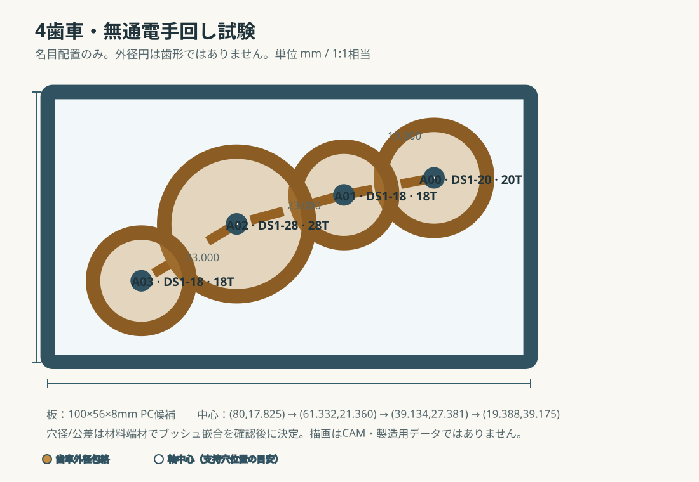

# 最初の4歯車・無通電手回し試験

更新日：2026-10-21

状態：**治具候補と試験条件を定義。製作図・購入許可・モーター通電許可ではない。**

## 目的

全28歯車を組む前に、KHK DS1の実歯形、5mm軸への固定、OILES 80B-0508の支持、PC板上のかみ合いを安価な4個だけで確認する。これはモーターなし・手回しの予備試験で、始動トルク・静音性・温度・全列の成立を証明しない。

## 試験する4個

基準レイアウトの前列A先頭を切り出し、元の軸中心距離をそのまま使う。図の円は外径包絡の模式表示で、歯形を表さない。

| ID | KHK歯車 | 歯数 | 治具板の中心 X,Y (mm) | 次軸まで |
|---|---|---:|---:|---:|
| A00 | DS1-20 | 20T | 80.000, 17.825 | 19.000mm |
| A01 | DS1-18 | 18T | 61.332, 21.360 | 23.000mm |
| A02 | DS1-28 | 28T | 39.134, 27.381 | 23.000mm |
| A03 | DS1-18 | 18T | 19.388, 39.175 | — |

座標は100×56mmの治具板左上を(0,0)とする。ケース内側の既存座標をX方向に46mm、Y方向に7.675mm平行移動して、歯車外径包絡を板の上下中央に寄せた値。軸中心距離はM1・20°の公称式 `a=(z1+z2)/2` と一致する。中心距離の実加工公差・歯当たりは現物試験で判断し、SVGの模式円を加工輪郭として使わない。

## 1台分の試験部品

| 部品 | 数量 | 備考 |
|---|---:|---|
| KHK DS1-18 | 2 | POM、18T、5mm穴 |
| KHK DS1-20 | 1 | POM、20T、5mm穴 |
| KHK DS1-28 | 1 | POM、28T、5mm穴 |
| 5mm h7平行ピン、長さ28mm | 4 | 基準BOMの単列軸から使用する候補 |
| OILES 80B-0508 | 4 | 1軸につき1個。残り24個は全体試験用候補 |
| KANA KSC0505カラー | 4 | 軸の抜け止め候補 |
| POM 5×10×1mmワッシャー | 4 | 支持板と歯車のすき間調整候補 |
| 透明PC、100×56×8mm | 1 | 8mm支持板用300×450mm規格板の切出し残余から取る候補。ブッシュ穴は同じ端材で適合確認後に決める |

実物の歯車・ピン・ブッシュがそろうまでは、同じ寸法の別材料で代用して合格扱いにしない。試験片への穴あけ、圧入、歯車固定は各メーカーの指定工具/方法で行い、割れ・白化・変形があれば中止する。ブッシュ座の仕上げ径は未指定であり、呼び径をそのまま加工指示にしない。

## 手順と記録

1. 4歯車、ピン、ブッシュ、カラー、ワッシャー、PC板の型番・ロット・実測外形/厚さを記録する。
2. 同じPC板材の端材でブッシュ嵌合片を作る。穴径、圧入力、板の割れ/白化、圧入後のブッシュ内径と軸の回転抵抗を記録する。適合穴が決まらなければ治具板を開けない。
3. 100×56×8mm板へ4軸中心を移し、穴間距離を測る。中心距離は19/23/23mmを目標とし、加工後は各距離と直角/平面度を記録する。
4. 4個の歯車を指定順に取り付ける。歯車をピンへ固定し、ピンがブッシュ内で回転する構造とする。カラーは軸抜けを抑えるだけとし、板や歯車へ締め付けない。
5. A00を指でゆっくり回し、隣接3組が一回転する範囲を少なくとも10周分手で動かす。必要なら試験片を外して固定方法を見直す。
6. 表裏から歯先、ハブ、ワッシャー、板の接触跡を確認し、異音/引っ掛かりの位置、軸方向ガタ、目視できる偏心、歯車の緩みを記録する。

## 合格条件

- 3組すべてで全周にわたり噛み合い、歯底への突き当たり、飛び、引っ掛かり、他歯車/板との擦れがない。
- 10周の手回し中に歯車と軸の相対滑り、割れ、抜け、ブッシュの移動、PCの亀裂/白化がない。
- 手を離した後に歯列が自走しない。これは無通電の機械試験なので、摩擦をモーター負荷や静音性の評価へ置き換えない。
- すべての実測値と写真を試験記録へ残す。失敗時は穴径/軸固定/間隔の原因を切り分け、最初の条件を消さずに再試験番号を付ける。

PASS後に初めて各列、全28個、駆動負荷、音/温度の試験へ進む。モーター通電は別の安全ゲートで許可されるまで行わない。現行ベースラインの発注/加工/通電/書込み保留は本書で解除しない。
