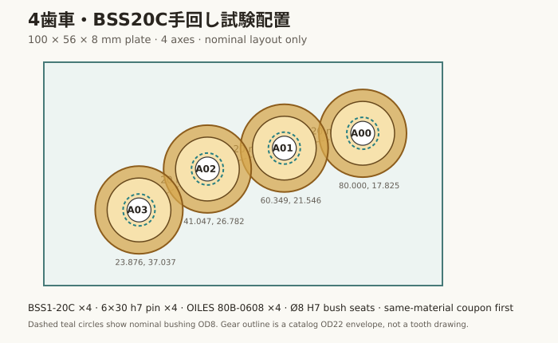
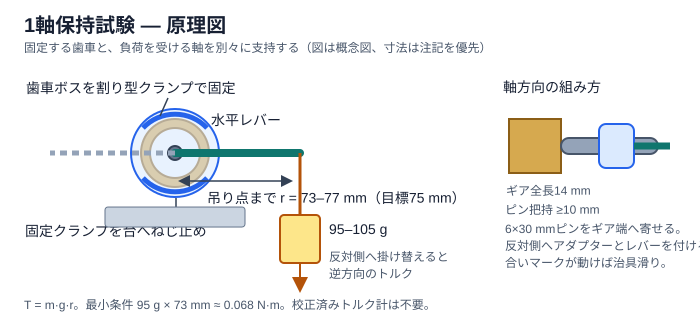

# 4歯車・無通電手回し試験

更新日：2026-10-22

状態：**参考手順。専用治具・圧入片・4歯車試験板は、初号機の購入・組立前提から外す。完成品の基本設計が閉じたら一台分をまとめ、本組立中の手回し/低速動作確認で適合を見る。**

2026-10-22方針更新：本書の下記治具・試験片・段階購入案は、必要になった場合の予備手順として保持します。現在の優先事項は完成品の一台分図面とBOMです。独立した0.06N·m保持試験は発注前ゲートにしません。実機組立時は、歯車と軸に合いマークを付け、手回し後にモーターを電流制限した低速で動かし、滑り/噛み込みを確認します。

現在の試験対象は[KHK BSS1-20C軸支持候補](bss20_axis_support_candidate-2026-10-22.md)です。以前のDS1/POM・5mm軸の試験案は本書の現行仕様ではありません。

## 目的

まず1軸でギア穴・h7ピン・M4止めねじ・ブッシュ・カラー・ワッシャーの適合を確認し、その後に4歯車の無通電手回しを行います。これは機械の予備試験です。全28位置の成立、モーター始動余裕、静音性、温度、完成受入を証明しません。

## 4歯車の配置

試験板左上を(0,0)とする100×56×8mmの1平面板です。穴はØ8 H7候補ですが、同じ材料のブッシュ圧入試験片がPASSした後に加工します。

圧入片・4歯車試験板・木溝片をまとめた[加工見積図 v0.1 (PDF)](bss20_support_coupon_quote_v0.1.pdf)を作成しました。寸法候補の見積用で、加工開始や製品板の加工指示ではありません。

| ID | KHK歯車 | 歯数 | 穴中心 X,Y (mm) | 次軸まで |
|---|---|---:|---:|---:|
| A00 | BSS1-20C | 20T | 80.000, 17.825 | 20.000mm |
| A01 | BSS1-20C | 20T | 60.349, 21.546 | 20.000mm |
| A02 | BSS1-20C | 20T | 41.047, 26.782 | 20.000mm |
| A03 | BSS1-20C | 20T | 23.876, 37.037 | — |

## 先に買う場合の1軸確認キット

購入判断を小さくするため、4個セットへ進む前に1軸の市販部品だけ照合します。

| 品目 | 購入単位/数量 | 今回使う数 | 価格表示（税込） |
|---|---:|---:|---:|
| [KHK BSS1-20C](https://www.monotaro.com/p/8339/7215/) | 1個（M4×4止めねじ1本付属） | 1 | ¥1,868 |
| [6×30mm SUS303 B種h7平行ピン](https://www.monotaro.com/p/4215/6807/) | 3本入り1袋 | 1 | ¥493 |
| [OILES 80B-0608](https://www.monotaro.com/p/0045/9313/) | 1個 | 1 | ¥51 |
| [KANA KSC0605](https://www.monotaro.com/p/1029/5117/) | 1個 | 1 | ¥208 |
| [POM 0612-10ワッシャー](https://www.monotaro.com/p/4213/5143/) | 12枚入り1袋 | 2枚 | ¥615 |
| **市販部品小計** |  |  | **¥3,235** |

同じ材料のØ8 H7圧入試験片と4穴試験板は特注加工となり、上の価格に含みません。評価材はAS ONE 68-7869-18（[300×450×8mm](https://axel.as-1.co.jp/asone/d/68-7869-18/)）の1枚に特定し、両方を同じ板から切り出します。材質表示・板厚・反りを受領時に記録し、先に20×20mm圧入片だけを作り、PASS後に4穴板を加工します。型番/材質の代替はしません。加工先の見積と歯車固定具・軸レバーの試作仕様がまだないため、上の市販部品だけでは指定試験を実施できません。校正済みトルク計は不要です。価格・在庫・納期は注文前に照合してください。

1軸がPASSした後に3軸分を追加すると、市販部品の追加分は¥6,874、4軸分で¥10,109です。ワッシャーは1袋12枚から8枚を使い、4枚を予備にします。

上記¥3,235は、型番照合と寸法確認を目的にした評価サンプル部品だけの価格です。**完成品用の購入指示ではありません。** 同材PCクーポン、側壁溝クーポン、保持トルク用の重り/割り型レバー治具、加工費、送料は含みません。BSS1-20CはMonotaROで5日以内出荷・返品不可表示のため、注文する場合はまず1個だけとし、4個以上へ増やしません。

## 0.06N·m保持試験の測定方法

校正済みトルク計は不要です。1g表示のキッチンスケールと1mm目盛りの定規で、95〜105gの荷重と73〜77mmのレバー長を合わせれば試験できます。重りは既知質量のおもり、または容器を含めて秤で量った荷重を使います。歯車ボスを台へ固定し、軸の突出端へレバーを付ける構成です。歯車側の固定具と軸側のレバーを同じ部品へ付けると相対トルクが掛からないため、分けて固定します。

- 歯車ボスØ16×8mmを、M4止めねじへ逃げを設けた割り型クランプで保持し、この固定具を試験台へ固定します。クランプは歯車本体だけを止めます。
- 軸の突出端（6mmピン）には、軸をつかむ別体アダプターと水平レバーを取り付けます。レバーは軸中心をまたいで左右対称にし、軸中心から重りの吊り点までの水平距離を73〜77mmにします。アダプターはピンを10mm以上つかみ、ピン/アダプター/レバー間の合いマークがずれないことを確認します。
- 95〜105gの重りをレバー片側へ静かに掛けます。反対側の吊り点を使うと負荷方向が逆になります。水平で重りを吊る前にレバーが自重で傾かないよう、左右を対称にしてバランスさせます。
- トルクは `T=m×g×r` で算出します。下限のm=0.095kg、g=9.80665m/s²、r=0.073mでも約0.0680N·mとなり、0.060N·mの要求を上回ります。代表値は100g×9.80665×0.075=0.0735N·mです。
- 歯車と軸に合いマークを付け、正逆それぞれ10秒保持を3回行います。重りは衝撃なく掛け、歯車と軸の相対位置が動かないことを確認します。歯車側固定具、軸アダプター、レバーのいずれかが滑った回は無効です。
- これは軸/歯車の保持を確認する静的試験で、モーターの動的トルクや製品安全認証を証明しません。

この原理図は配置説明用で、加工図ではありません。実際の治具は上記の最小寸法を加工見積へ渡し、作りやすい割り型/台座構造を提案してもらいます。

### 試験治具の見積用寸法案

これは評価治具の概寸で、製品部品や厳密な加工図ではありません。加工者が作りやすい構成を見積に示せるようにします。

- **固定側：** 歯車ボスØ16×8mmをつかむ割り型リング（内径は公称Ø16.5mm、幅8mm）を作り、二本のねじで試験台へ固定します。M4止めねじ位置には逃げを設けます。リングは歯車の歯ではなくボスだけを固定します。ゆるい場合は薄い樹脂シムを挟み、圧入寸法にはしません。
- **回転側：** ピン突出端の6mm軸を10mm以上つかむ割り型アダプターを作り、10×3×160mm程度の平らなレバーを軸中心に取り付けます。レバー両端は軸中心から75mm。重りの吊り位置は定規で73〜77mmに合わせ、反対側へ移すと逆方向になります。
- **確認：** 固定リング、軸アダプター、レバーへ合いマークを付けます。試験荷重中に歯車/ピン以外のマークが動いたら治具の滑りなのでその回は無効です。POM/ナイロン等の樹脂か金属で見積を取り、工具で作れる材料を加工者に提案してもらいます。

## 手順

1. 受領品の型番、注文コード、数量、外形、歯車穴、ピン径、ブッシュ/カラー/ワッシャー寸法を記録する。別材料や別型番での代用はしない。
2. 同じPC材・厚さの20×20×8mm試験片へØ8 H7穴を加工し、OILES 80B-0608を圧入する。穴寸法と圧入力、板の割れ/白化、圧入後のブッシュ内径を加工先の測定票または手元の測定値で記録する。6mm h7ピンが引っ掛からず回り、ブッシュが抜けないことを確認する。
3. **保持トルク治具は、ブッシュ/支持板/カラーを使わない状態で組む。** BSS1-20Cの全長は14mm、6×30mmピンは30mmなので、歯車をピンの一端へ寄せれば反対側に16mm残り、10mm以上つかむレバーアダプターを付けられる。歯車ボスを割り型クランプで試験台へ固定し、反対側のピンへレバーを付ける。BSS1-20CにはM4×4止めねじが1本付属する仕様です。受領数を確認し、止めねじは別売購入しない。
4. 95〜105gの総荷重をレバー端へ吊るして両方向に各10秒、3回負荷する。保持中または除荷後に歯車と軸の相対移動が残れば不合格。治具の合いマークが動いた場合は試験無効。無理に止めねじを締め増さず停止する。
5. 保持試験がPASSした後、圧入試験片のブッシュへピンを入れて手で回し、引っ掛かり/抜けがないことを確認する。続いて1軸のカラー/ワッシャースタックを組み、軸方向ガタと回転抵抗を記録する。
6. 1軸ゲートがPASSした後に同材の4穴板を作る。各ブッシュ穴はØ8 H7、隣り合う噛合い軸間は20mmを基準にKHK推奨のH8プラス側とし、加工後に穴径と3組の軸間距離を確認する。CAD座標の小数桁は加工公差ではない。
7. A00〜A03を同一Zスタックで取り付ける。軸方向はA単軸z=1…31、カラー1…6、カラー側ワッシャー6…7、支持板7…15、ギア側ワッシャー15…16、ボス16…24、歯面24…30mm。
8. A00をゆっくり回し、正逆各10回転させる。表裏から歯、ボス、ワッシャー、板、ブッシュを観察し、擦れや引っ掛かりの位置を記録する。

## PASS条件

- 圧入した板に割れ/白化/変形がなく、ブッシュの移動がない。
- ピンがブッシュ内で滑らかに回り、軸方向ガタと測定値を記録できる。
- 重りの質量、軸中心〜吊り点の距離、算出トルクを記録し、治具が滑らず歯車とピンの相対滑りがない。
- 6×30ピンは3本入り1袋を買い1本を使用、2本を予備にする。ワッシャーは12枚入り1袋から2枚を使い、10枚を次段階/予備に回す。
- 3組すべてが全周にわたり噛み合い、歯飛び、歯底突き当たり、板/ワッシャーとの接触がない。
- 4歯車の正逆10回転中に、ギア固定のずれ、ブッシュ抜け、異常な偏心、破損がない。
- 測定値、型番/ロット、組立写真、異音/抵抗の記録を残す。

PASSしても全28位置や静音性の合格にはしません。PASS後に全量の軸/支持板/電装位置を同じ版で照合し、電流制限したモーター試験を別手順で行います。1軸評価サンプルの型番と販売単位は特定済みですが、ここでは購入を実行していません。
