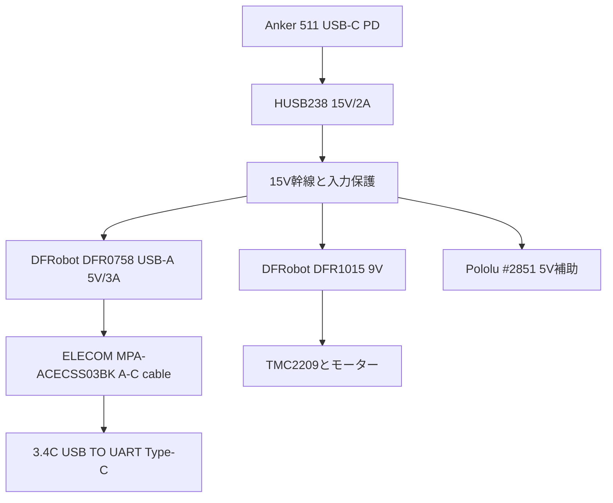

# USB-C表示給電 — 既製モジュール候補 v0.1

- 更新日: 2026-10-22
- 状態: **カタログ型番選定済み。購入・通電・実機受入は未実施**
- 判断記録: [ADR-0019](../../adr/0019-cots-usb-c-power-module.md)

## 給電経路

| 役割 | 選定品・設定 | カタログ仕様と使い方 |
|---|---|---|
| 外部PD電源 | Anker 511 Charger (Nano 3, 30W) A2147 | 15V/2A、最大30Wのプロファイルを使用。既存候補の型番を維持し、出力だけ15Vへ変更。 |
| PD受電 | Adafruit HUSB238 #5807 | 15Vを要求し、電流選択も2Aへ設定。I²Cや追加ソフトウェアは使わない。 |
| 表示器用5V source | DFRobot DFR0758 + ELECOM MPA-ACECSS03BK | DFR0758は入力10.5–32V、USB出力5V/最大3A。USB-A出力から、USB-A - Type-C、0.3m、最大5V/3AのMPA-ACECSS03BKで3.4Cへ接続する。DFR0758の二つの出力は並列なのでUSB-Aだけを使い、Type-C出力は空ける。 |
| モーター電源 | DFRobot DFR1015 | 入力7.5–30V、選択式9V出力。9V設定で25°C・追加放熱なしの仕様値は最大2.5A。既存のTMC2209 #6121向け9V枝を保つ。基板寸法27×20mm。 |
| 補助5V | Pololu D24V50F5 #2851 | 15V入力でLED等の補助負荷を供給。表示器sourceへは接続しない。 |

DFR0758の入力は製品記載のDC 5.5×2.1mmジャックを使う。HUSB238の15V/GND端子から市販のプラグ付き2線ピグテールでつなぎ、極性はモジュールの印字に従う。印字と導通を確認してから通電する。DFR0758の実外形と穴位置は公開されていないため、125×120mmの既存サービス域へ調整式キャリアで留める。ケース壁に固定穴を開けるのは受領後に位置を決めてからでよい。

## 取り回しとヒューズ

- PD出力15Vは分岐点で表示source、モーター9V変換、補助5V変換へ分ける。
- 表示source入力はDFR0758の保護機能を使い、15V側に既選定の入力/分岐保護を置く。DFR0758出力にTPS25810や追加USB-C receptacleを重ねない。
- モーター枝は15V → 分岐ヒューズ候補 → DFR1015(9V) → 2A MINIヒューズ候補 → 独立SPST → TMC2209 VMとする。SMBJ12Aは9V側VM-GND間へ置く。
- LED枝は15V → #2851(5V) → 補助枝ヒューズ候補 → LED用SPST → LED。
- 3.4C給電にはELECOM MPA-ACECSS03BK（0.3m A-C）を使う。ファームウェア書込み時は内部給電ケーブルを抜いてPCを接続し、外部PD電源とPC USBからの二重給電を避ける。

## 購入判断と一度だけ行う受入

DFR0758、DFR1015、HUSB238、Anker 511、A-Cケーブルはいずれも標準型番で、特注見積や専用PCBは不要。DFR0758の公開仕様に10.5–32V入力と5V/3A出力があり、ケーブルも最大5V/3Aで選定している。価格・在庫・日本への送料は購入時に販売店表示で確認する。

受領後、3.4Cをつなぎ、起動・最大輝度・Wi-Fi・microSDを同時に動かして表示器端の電圧、PD入力電力、変換器/ドライバー温度を確認する。異常時はその枝だけ停止して配線または部品を見直す。基板寸法の正確な採寸、カスタム保証値、USB認証書類、専用トルク治具は一台の初号機を進めるための購入前条件にしない。

## 一次資料

- [Anker 511 A2147](https://www.ankerjapan.com/products/a2147)
- [Adafruit HUSB238 #5807](https://www.adafruit.com/product/5807)
- [DFRobot DFR0758](https://www.dfrobot.com/product-2166.html)
- [DFRobot DFR1015](https://www.dfrobot.com/product-2599.html)
- [ELECOM MPA-ACECSS03BK](https://www.elecom.co.jp/products/MPA-ACECSS03BK.html)
- [Adafruit TMC2209 #6121](https://www.adafruit.com/product/6121)
- [Pololu D24V50F5 #2851](https://www.pololu.com/product/2851)
