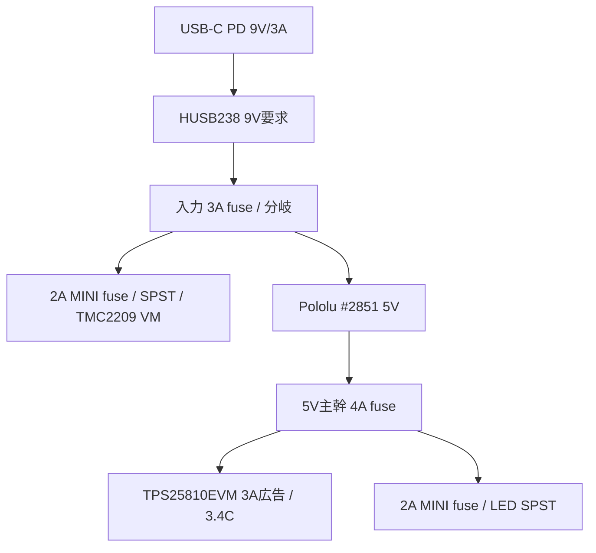

# 電源・制御ベースライン

統合正本は[設計ベースラインv0.21](../10-desk-redesign/design-baseline-v0.21.md)。電源/モーター候補と置換理由は[ADR-0014](../../adr/0014-new-power-and-motor-safety-baseline.md)を参照します。全値は一台試作候補で、計測受入までは製造値ではありません。

## 電源枝

- 電源候補はAnker 511 30W PD電源 + HUSB238 #5807の固定9V/3A要求。
- 9V入力からモーター枝とPololu D24V50F5 #2851の5V枝を分ける。#2851の5Aはtypical continuous能力値で、閉箱の連続容量を示さない。
- 表示器へは5VからTI TPS25810EVM-745を介してType-C 3Aを広告する。EVMは評価基板で、3A広告時のICリミットtyp. 3.40Aを負荷許容値として使わない。#3411のCC抵抗手変更案はADR-0014で置換。
- 5Vの負荷上限計算は表示15W + LED最大1.32W =16.32W (約3.264A)。表示実電流は受入時に計測する。
- 電源戻りは分岐点までモーター枝と5V/表示枝を分け、相電流を表示GND/USBケーブルへ流さない。
- 3.4Cの40-pin拡張ヘッダーへ5Vを注入しない。通常時はUSB TO UART Type-Cを5V給電に使い、フラッシュ/デバッグ時はPD sourceケーブルを外してPCを接続する。同時給電しない。

## モーター枝

- モーター候補はAdafruit NEMA-8 #4411 + TMC2209 #6121、200 step/rev、1/8分割、0.30A RMS/相から評価、軸速度1.6rpm。
- STEP/DIR/ENN候補GPIOは4/5/32。対象基板の改版確認まで実配線しない。
- ENNはactive-low。外部10kΩ pull-upでVIO/3.3Vへ保持し、ファームウェアは初期化時にENN HIGH、通常ビルドは `CONFIG_DIALCANVAS_MOTOR_OUTPUT` 無効。
- 9V→2A MINIヒューズ候補→NKK MN11SS1W01 SPST→TMC2209 VMの順。独立スイッチがVMを直列遮断し、旧M1 eFuseに依存しない。
- STEPに10kΩ pulldown候補を置き、reset/brownout時の不要パルスを抑える。ドライバーのVIO、ENN論理、基板既定プルは現物で照合する。
- SMBJ12AをVM/GND近傍に置く候補。TVSはVRWM=12V、仕様上の最大クランプ19.9V。回生/急停止時の波形とエネルギーは未受入。

## モーター配線とドライバー位置

Adafruit NEMA-8 #4411とTMC2209 #6121の型番は選定済みです。#4411は約406mmの4芯リード線付きですが、メーカーは線径を公表していません。#6121のモーター端子は26–20AWGなので、実線を無理に差し込む設計にはしません。配線案、巻線の識別、AWG22への接続方法、背面カバー上の基板候補位置は[モーター・ドライバー接続案](motor-harness-interface.md)に定義しました。

現行CADへ#6121の26.6×24.1×10.3mm包絡を、背面着脱カバー内側の中心X=+35mm、Y=+68mmに追加しました。基板とモーターの名目包絡は重なりません。CADは端子、線の曲げ、固定具を描かないため、実線を入手した後の挟み込み/引張り/カバー開閉試験は残ります。

## 補助電装の背面配置候補 v0.1

組み上がり時の正面/側面/背面配置は[内部配置図 v0.1（PNG）](assembled-layout-overview-candidate-v0.1.png)で確認できます。拡大・印刷用の[PDF](assembled-layout-overview-candidate-v0.1.pdf)、[SVG原図](assembled-layout-overview-candidate-v0.1.svg)、[生成スクリプト](generate_assembled_layout_overview.py)も置いています。説明用の候補図で、加工/購入図ではありません。

表示・主制御はWaveshare ESP32-P4-WIFI6-Touch-LCD-3.4C SKU31523の一体基板を使います。**別の表示/主制御基板は追加しません。** ここで配置するのは、電源変換、Type-C source、RTC、モータードライバー、分岐端子などの補助部品です。

補助部品は、背面から外せる木製カバーの内面へ個別の絶縁スペーサー/保持具で取り付ける候補です。基準座標はケース内面中心を(0,0)、右を+X、上を+Yとし、内面位置はz=121mmです。外寸270×205×145mm、内寸246×181×121mmを仮置きした場合に使える面積はX=±123mm、Y=±90.5mmです。3.4C基板の背面端はz=60mm候補なので、背面カバー内面との距離は名目61mmあります。これは同じ平面に基板を二重配置する案ではなく、表示器より後ろのサービス面を利用する案です。

下記の配置図は、わかっている公称基板外形を使った位置候補と、端子/作業用の割当エリアを示します。位置は**部品の面内中心候補**であり、固定穴中心やケース加工座標ではありません。ケース寸法も配置検討用の参照値で、外箱寸法は未凍結です。

| 部品/機能 | 面内中心・割当範囲 | 外形/配置根拠 | 状態 |
|---|---|---|---|
| HUSB238 #5807 | X=-86, Y=+58mm | 基板公称24.5×20.2mm | 位置候補。Type-C入力の外向き/ケース穴/ケーブルは未決 |
| Pololu D24V50F5 #2851 | X=-48, Y=+58mm | ヘッダーなし公称17.8×20.3mm | 位置候補。端子/放熱/固定具は未決 |
| DS3231 #3013 | X=+85, Y=+50mm | 公称23×17.6mm。NEMA-8の背面投影と端子領域を避ける | 位置候補。CR1220交換方向とI²C線は未決 |
| TMC2209 #6121 | X=+35, Y=+68mm | 公称26.6×24.1×10.3mm | 既存CAD位置を維持。端子工具/モーター線アクセスは未決 |
| TPS25810EVM-745 | X=-118…+7, Y=-85…+35mmを割当（125×120mm） | **メーカー基板外形ではない**。TIの公開ユーザーガイドは基板レイアウト図を掲載するが、この基板の寸法入り外形/固定穴表は確認できない | 割当エリア候補。実基板とコネクター/ジャンパの収まり未確認 |
| WAGO 221-503×4、分岐/ヒューズ/スイッチ | X=+15…+115, Y=-85…+35mmを共通サービス区として割当（100×120mm） | 電源分岐4ノード分の221-503キャリア公称52.8×23.7×16.9mmを4個配置する候補。図の4矩形は90°回転した平面包絡で、線の挿入/レバー操作の余裕を含まない | 4個分の割当候補。実端子、ヒューズ保持具、スイッチ位置/形状、工具空間、固定は未決 |

TI資料でTPS25810EVM-745の評価用基板であること、USB-C端子・DCジャック・ジャンパ・テスト点があることは確認できますが、寸法入りの基板外形/穴図は見つかりませんでした。[TIユーザーガイド](https://www.ti.com/lit/pdf/SLVUAI0)の図面を実寸と誤認せず、左下に125×120mmの**割当枠**を取り、実物の外形と操作アクセスがこの枠に収まるかを確認します。これはTI基板が125×120mm以下だという仕様主張ではありません。収まらない場合はケース外形を再調整するか、Type-C source方式を見直します。

補助電装の取付・接続・候補配線経路は[背面補助電装の取付・配線候補](rear-harness-and-mount-candidate-v0.1.md)に整理しました。WAGO×4の平面包絡を図へ反映した段階ですが、レバー操作/電線曲げの空間、ヒューズ保持具の実寸、背面コネクター方向、表示/モーター線が歯車や支持板へ触れない立体経路、基板の固定具、閉箱時の熱は未受入です。配置座標は部品中心/割当域で、ケース穴や購入仕様ではありません。

## 候補ヒューズ

| 場所 | 試作候補 | 受入時に確認 |
| --- | ---: | --- |
| PD 9V入力 | Littelfuse MINI 297 MIN3 (3A) | 9V/3A契約、起動ピーク、ホルダー/導線の温度、ヒューズ時間特性 |
| モーター枝 | Littelfuse MINI 297 MIN2 (2A) | 相電流、ドライバー故障、配線保護と誤溶断 |
| 5V主幹 | Littelfuse MINI 297 MIN4 (4A) | 表示とLED合計、#2851/端子/配線の定格 |
| LED枝 | Littelfuse MINI 297 MIN2 (2A) | LED長、実電流、拡散材/木部温度 |

ヒューズは定格電圧32VのMINI 297系列へ揃え、同系列にない旧1A候補を2Aへ置き換えた。市販5個箱の選択はMIN2/MIN3/MIN4。値は初号機の候補で、実負荷・配線・閉箱温度の受入後に確定する。一次資料：[Littelfuse MINI aftermarket](https://www.littelfuse.com/products/fuses-overcurrent-protection/fuses/automotive-aftermarket-products-fuses/blade-fuses-shunts-automotive-aftermarket/mini)、[297 MINIデータシート](https://www.littelfuse.com/assetdocs/littelfuse-datasheet-297-mini32v?assetguid=42c9dd21-a88e-4328-8e67-2f832444faf1)。

## 受入順序

1. 通電前に極性、導通、短絡、分岐、スイッチ直列経路、EVMジャンパ設定、コネクター保持を照合する。
2. モーター枝を切り離し、9V PD契約、5V出力、表示最大負荷を測る。
3. LED単独の電流、照明、拡散、木部温度を確認する。
4. モーターは無通電手回し確認後に単体動作し、ENN初期値、物理遮断、モーター電流、VM過渡を測定する。
5. 全負荷・閉箱で電圧降下、温度、リセット、故障/再始動条件を記録する。

段階評価を終えるまでDR-05はOPENです。購入、加工、通電は文書上の候補選定だけでは開始しません。
