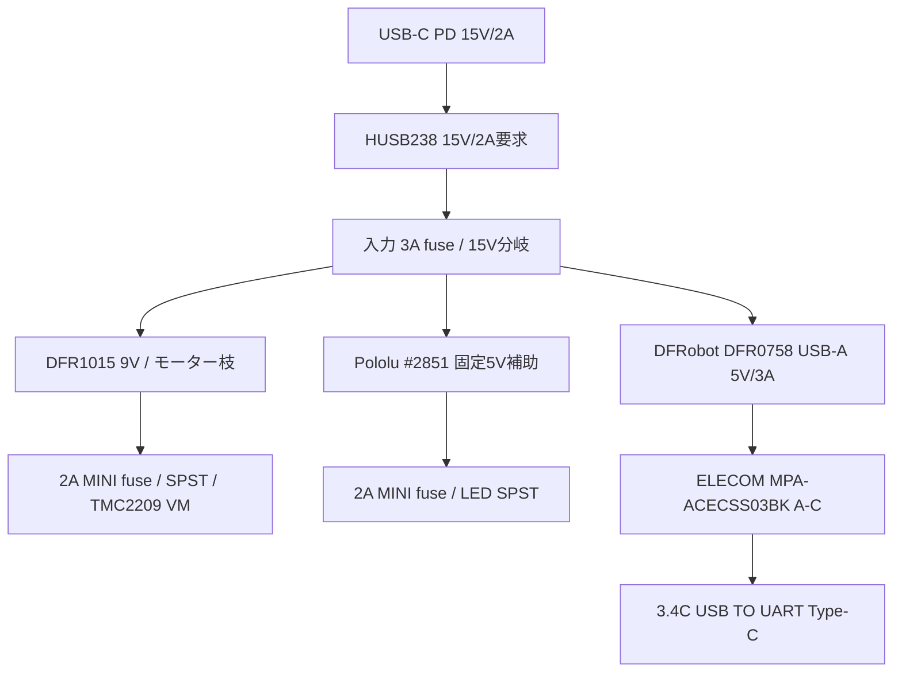
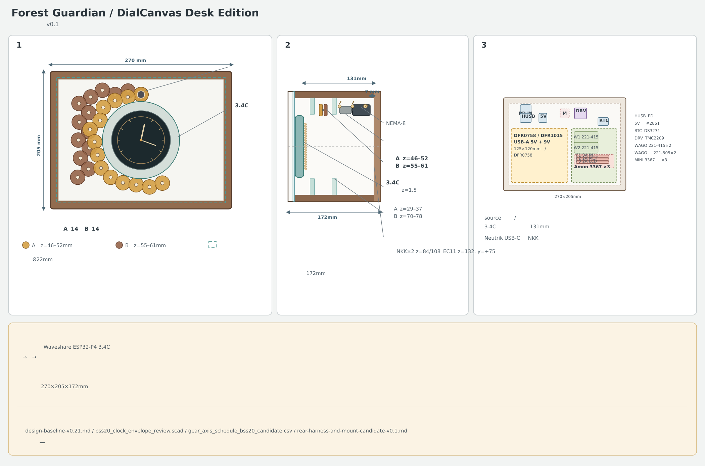
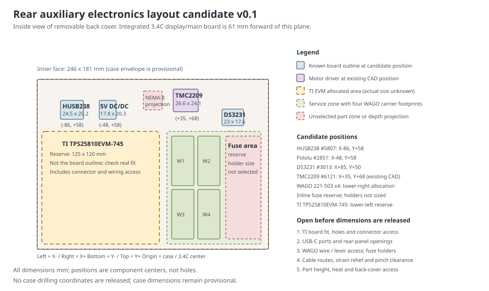

# 電源・制御ベースライン

統合正本は[設計ベースラインv0.21](../10-desk-redesign/design-baseline-v0.21.md)。既製電源モジュールは[ADR-0019](../../adr/0019-cots-usb-c-power-module.md)、モーター保護の根拠は[ADR-0014](../../adr/0014-new-power-and-motor-safety-baseline.md)を参照します。カタログ品は選定済みですが、実機での負荷・温度・保護受入は未実施です。

## 電源枝

- 外部電源はAnker 511 A2147（30W）+ HUSB238 #5807の15V/2A要求。幹線最大は15V/2A=30Wで、9V/3A構成は現行案から外す。
- 15Vから、DFR1015経由の9Vモーター枝、Pololu D24V50F5 #2851固定5V補助枝、DFRobot DFR0758表示器枝へ分ける。#2851はLED等の補助負荷用で、表示器を同じ5V枝へ直結しない。#2851の5Aは変換器定格で、閉箱内のシステム容量を示さない。
- 表示器はDFR0758のUSB-A 5V出力から、ELECOM MPA-ACECSS03BK（0.3m A-C、最大5V/3A）でUSB TO UART Type-Cへ給電する。DFR0758のUSB-A/Type-C出力は並列なのでUSB-Aだけを使い、Type-C出力は空ける。DFR0758は10.5–32V入力、標準5V/最大3A出力、過電流/短絡等の保護を公表。
- #2851枝の既知LED負荷は最大1.32W (0.264A@5V)。DFR0758の15Wは出力上限であり、表示器の実消費電力ではない。30W PD枠に対する全系統の余裕は実負荷を同時に動かすまで未確定。
- 電源戻りは分岐点までモーター枝と5V/表示枝を分け、相電流を表示GND/USBケーブルへ流さない。
- 3.4Cの40-pin拡張ヘッダーへ5Vを注入しない。通常時はUSB TO UART Type-Cを5V給電に使い、フラッシュ/デバッグ時はPD sourceケーブルを外してPCを接続する。同時給電しない。

## モーター枝

- モーター候補はAdafruit NEMA-8 #4411 + TMC2209 #6121、200 step/rev、1/8分割、0.30A RMS/相から評価、軸速度1.6rpm。
- STEP/DIR/ENN候補GPIOは4/5/32。Waveshare公開回路図を設計基準にし、実基板への基本配線確認は完成品組立時に行う。個体リビジョン確認は購入条件にしない。
- ENNはactive-low。外部10kΩ pull-upでVIO/3.3Vへ保持し、ファームウェアは初期化時にENN HIGH、通常ビルドは `CONFIG_DIALCANVAS_MOTOR_OUTPUT` 無効。
- 15V→DFR1015で9V→MINI 297 2Aヒューズ→NKK MN11SS1W01 SPST→TMC2209 VMの順。独立スイッチがVMを直列遮断し、旧M1 eFuseに依存しない。LED枝は別の同型SPSTで遮断する。
- STEPに10kΩ pulldown候補を置き、reset/brownout時の不要パルスを抑える。ドライバーのVIO、ENN論理、基板既定プルは現物で照合する。
- SMBJ12AをVM/GND近傍に置く候補。TVSはVRWM=12V、仕様上の最大クランプ19.9V。回生/急停止時の波形とエネルギーは未受入。

## モーター配線とドライバー位置

Adafruit NEMA-8 #4411とTMC2209 #6121の型番は選定済みです。#4411は約406mmの4芯リード線付きですが、メーカーは線径を公表していません。#6121のモーター端子は26–20AWGなので、実線を無理に差し込む設計にはしません。配線案、巻線の識別、AWG22への接続方法、背面カバー上の基板候補位置は[モーター・ドライバー接続案](motor-harness-interface.md)に定義しました。

現行CADへ#6121の26.6×24.1×10.3mm包絡を、背面着脱カバー内側の中心X=+35mm、Y=+68mmに追加しました。基板とモーターの名目包絡は重なりません。CADは端子、線の曲げ、固定具を描かないため、実線を入手した後の挟み込み/引張り/カバー開閉試験は残ります。

## 補助電装の背面配置候補 v0.1

組み上がり時の正面/側面/背面配置は[内部配置図 v0.1（PNG）](assembled-layout-overview-candidate-v0.1.png)で確認できます。拡大・印刷用の[PDF](assembled-layout-overview-candidate-v0.1.pdf)、[SVG原図](assembled-layout-overview-candidate-v0.1.svg)、[生成スクリプト](generate_assembled_layout_overview.py)も置いています。電源モジュール案は[既製USB-C表示給電候補](cots-usb-c-power-module-candidate-v0.1.md)。説明用の候補図で、加工/購入図ではありません。

表示・主制御はWaveshare ESP32-P4-WIFI6-Touch-LCD-3.4C SKU31523の一体基板を使います。**別の表示/主制御基板は追加しません。** ここで配置するのは、電源変換、Type-C source、RTC、モータードライバー、分岐端子などの補助部品です。

補助部品は、背面から外せる木製カバーの内面へ個別の絶縁スペーサー/保持具で取り付けます。基準座標はケース内面中心を(0,0)、右を+X、上を+Yとし、内面位置はz=148mmです。外寸270×205×172mm、内寸246×181×148mmの参照値で使える面積はX=±123mm、Y=±90.5mmです。3.4C基板の背面端z=17mmから背面カバー内面まで名目131mmあります。表示器より後ろのサービス面を利用します。

下記の配置図は、わかっている公称基板外形を使った位置候補と、端子/作業用の割当エリアを示します。位置は**部品の面内中心候補**であり、固定穴中心やケース加工座標ではありません。ケース寸法も配置検討用の参照値で、外箱寸法は未凍結です。

| 部品/機能 | 面内中心・割当範囲 | 外形/配置根拠 | 状態 |
|---|---|---|---|
| HUSB238 #5807 | X=-86, Y=+58mm | 基板公称24.5×20.2mm | 位置候補。Neutrik NAUSBC-5G-FL10（100mm）から接続 |
| Pololu D24V50F5 #2851 | X=-48, Y=+58mm | ヘッダーなし公称17.8×20.3mm | 位置候補。端子/放熱/固定具は未決 |
| DS3231 #3013 | X=+85, Y=+50mm | 公称23×17.6mm。NEMA-8の背面投影と端子領域を避ける | 位置候補。CR1220交換方向とI²C線は未決 |
| TMC2209 #6121 | X=+35, Y=+68mm | 公称26.6×24.1×10.3mm | 既存CAD位置を維持。端子工具/モーター線アクセスは未決 |
| 表示・電源変換モジュール域 | X=-118…+7, Y=-85…+35mmを機能/作業用に仮割当（125×120mm） | DFRobot DFR0758（実外形未公表）、DFR1015（27×20mm）、入力ハーネスを含む予約域 | DFR0758は調整式キャリア。基板の個別穴寸法は購入条件にしない |
| WAGO 221-415×2、221-505×2、Amon 3367×3 | X=+15…+115, Y=-85…+35mmの共通サービス区 | 221-415は5極の+15V分配/GND共通用。221-505は5極端子用取付台。Amon 3367は15V入力、モーター、LEDの各ヒューズ枝に1個 | 型番・一台用数量を選定。導線切断と端子挿入は組立時 |

左下の125×120mmは電源変換モジュールと作業空間の**予約枠**で、単一基板の外形ではありません。#4092特注とTPS25810専用基板は使いません。DFR0758の外形は未公表なので調整式キャリアで枠内へ保持します。

補助電装の取付・接続は[背面補助電装の取付・配線候補](rear-harness-and-mount-candidate-v0.1.md)に整理しました。WAGO 221-415×2/221-505×2、Amon 3367×3、NKK MN11SS1W01×2、ALPS EC11E15244G1を選定しました。側面操作部は前面ガード内面からz=84/108/132mm、y=+75mmに並べます。NKK穴はØ6.5mm+キー溝、エンコーダー軸穴はØ7mmです。12mm壁の裏面を18×18×9.4mm座ぐりし、スイッチ部は2.6mmを残します。背面USB-C入力はNeutrik NAUSBC-5G-FL10とし、メーカーD型開口/固定穴を後板図へ転記します。

## 一台用のヒューズ選定

| 場所 | 試作候補 | 受入時に確認 |
| --- | ---: | --- |
| PD 15V入力 | Littelfuse 0297003.LXN (MINI 297, 3A) ×1 | 15V/2A電源の入力枝 |
| モーター枝 | Littelfuse 0297002.LXN (MINI 297, 2A) ×1 | DFR1015 9V出力後のモーターVM枝 |
| LED枝 | Littelfuse 0297002.LXN (MINI 297, 2A) ×1 | #2851出力からLEDへ。既知最大0.264Aの枝 |

ヒューズは32V MINI 297系列から3個選定しました。入力3A、モーター2A、LED2Aです。#2851からLEDへの補助5V幹線ヒューズは追加せず、LED枝に1個置きます。販売単位は2A/3A各5個箱を使い、余りは予備です。一次資料：[Littelfuse MINI 297データシート](https://www.littelfuse.com/assetdocs/littelfuse-datasheet-297-mini32v?assetguid=42c9dd21-a88e-4328-8e67-2f832444faf1)。完成品で枝電流と温度を確認します。

## 受入順序

1. 通電前にモジュールの設定/極性、導通、短絡、分岐、スイッチ直列経路、コネクター保持を照合する。
2. モーター枝を切り離し、15V PD契約とDFR0758→A-Cケーブル→3.4Cの表示電源経路を確認する。#2851枝はLEDと補助負荷だけを測る。
3. LED単独の電流、照明、拡散、木部温度を確認する。
4. モーターは無通電手回し確認後に単体動作し、ENN初期値、物理遮断、モーター電流、VM過渡を測定する。
5. 全負荷・閉箱で電圧降下、温度、リセット、故障/再始動条件を記録する。

段階評価を終えるまでDR-05はOPENです。購入、加工、通電は文書上の候補選定だけでは開始しません。
