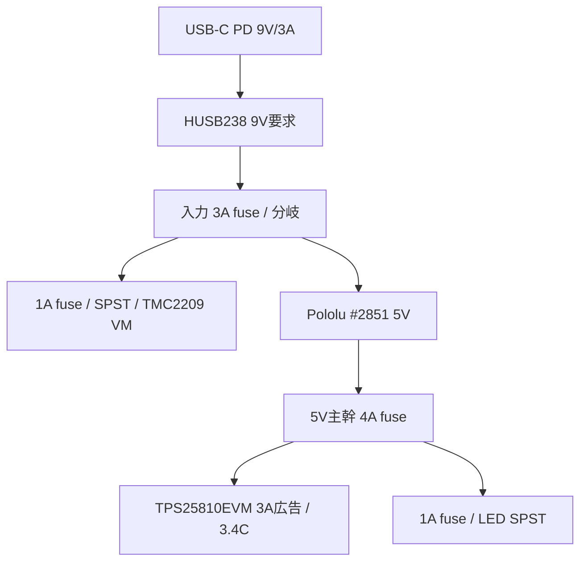

# 電源・制御ベースライン

統合正本は[設計ベースラインv0.21](../10-desk-redesign/design-baseline-v0.21.md)。電源/モーター候補と置換理由は[ADR-0014](../../adr/0014-new-power-and-motor-safety-baseline.md)を参照します。全値は一台試作候補で、計測受入までは製造値ではありません。

## 電源枝

- 電源候補はAnker 511 30W PD電源 + HUSB238 #5807の固定9V/3A要求。
- 9V入力からモーター枝とPololu D24V50F5 #2851の5V枝を分ける。#2851の5Aはtypical continuous能力値で、閉箱の連続容量を示さない。
- 表示器へは5VからTI TPS25810EVM-745を介してType-C 3Aを広告する。EVMは評価基板で、3A広告時のICリミットtyp. 3.40Aを負荷許容値として使わない。#3411のCC抵抗手変更案はADR-0014で置換。
- 5Vの負荷上限計算は表示15W + LED最大1.32W =16.32W (約3.264A)。表示実電流は受入時に計測する。
- 電源戻りは分岐点までモーター枝と5V/表示枝を分け、相電流を表示GND/USBケーブルへ流さない。
- 3.4Cの40-pin拡張ヘッダーへ5Vを注入しない。通常時はUSB TO UART Type-Cを5V給電に使い、フラッシュ/デバッグ時はPD sourceケーブルを外してPCを接続する。同時給電しない。

## モーター枝

- モーター候補はAdafruit NEMA-8 #4411 + TMC2209 #6121、200 step/rev、1/8分割、0.30A RMS/相から評価、軸速度1.6rpm。
- STEP/DIR/ENN候補GPIOは4/5/32。対象基板の改版確認まで実配線しない。
- ENNはactive-low。外部10kΩ pull-upでVIO/3.3Vへ保持し、ファームウェアは初期化時にENN HIGH、通常ビルドは `CONFIG_DIALCANVAS_MOTOR_OUTPUT` 無効。
- 9V→1Aヒューズ候補→NKK MN11SS1W01 SPST→TMC2209 VMの順。独立スイッチがVMを直列遮断し、旧M1 eFuseに依存しない。
- STEPに10kΩ pulldown候補を置き、reset/brownout時の不要パルスを抑える。ドライバーのVIO、ENN論理、基板既定プルは現物で照合する。
- SMBJ12AをVM/GND近傍に置く候補。TVSはVRWM=12V、仕様上の最大クランプ19.9V。回生/急停止時の波形とエネルギーは未受入。

## 候補ヒューズ

| 場所 | 試作候補 | 受入時に確認 |
| --- | ---: | --- |
| PD 9V入力 | 3A | 9V/3A契約、起動ピーク、ホルダー/導線の温度、ヒューズ時間特性 |
| モーター枝 | 1A | 相電流、ドライバー故障、配線保護と誤溶断 |
| 5V主幹 | 4A | 表示とLED合計、#2851/端子/配線の定格 |
| LED枝 | 1A | LED長、実電流、拡散材/木部温度 |

## 受入順序

1. 通電前に極性、導通、短絡、分岐、スイッチ直列経路、EVMジャンパ設定、コネクター保持を照合する。
2. モーター枝を切り離し、9V PD契約、5V出力、表示最大負荷を測る。
3. LED単独の電流、照明、拡散、木部温度を確認する。
4. モーターは無通電手回し確認後に単体動作し、ENN初期値、物理遮断、モーター電流、VM過渡を測定する。
5. 全負荷・閉箱で電圧降下、温度、リセット、故障/再始動条件を記録する。

段階評価を終えるまでDR-05はOPENです。購入、加工、通電は文書上の候補選定だけでは開始しません。
