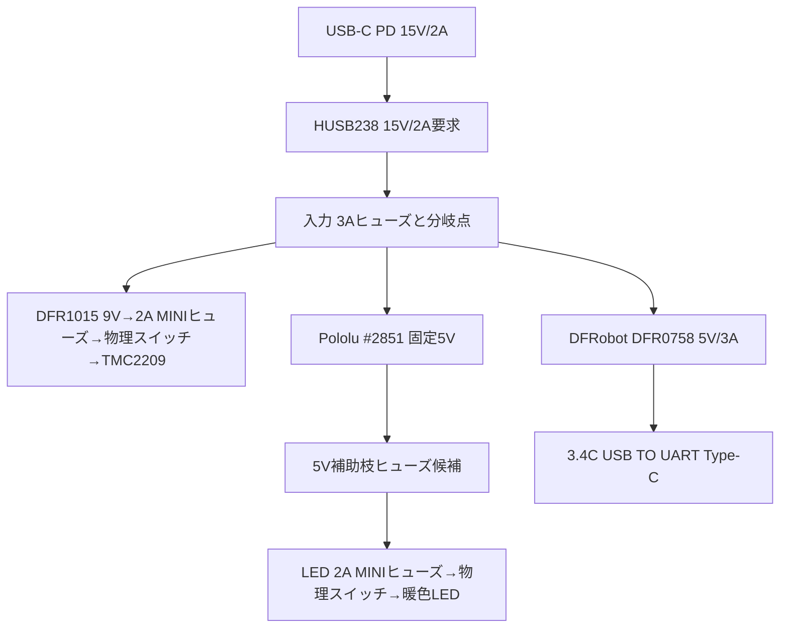

# Forest Guardian / DialCanvas Desk Edition — 設計ベースライン v0.21

- 基準日: 2026-10-22
- 状態: **一台試作の机上設計ベースライン。製作・通電・量産リリースではない**
- 要求台帳: [v0.21 requirements.yaml](../01-requirements/requirements.yaml)
- 決定記録: [ADR一覧](../../adr/README.md)。Type-C表示給電は[ADR-0019](../../adr/0019-cots-usb-c-power-module.md)で既製品構成へ更新。
- 現在の作業/受入状態: [worklist.csv](worklist.csv)、[状態記録](status-2026-10-21.md)

この文書を現行Desk Editionの構成・インターフェース・候補値の統合基準とする。旧7軸設計の資料とブランチは履歴・参照専用で、新設計の要求、証拠、進捗へ混ぜない。部品、寸法、電気値に `PROVISIONAL` を付した項目は試作候補として一つに揃えた値であり、実物で受入れるまで製造値にはならない。

**このv0.21は一台用の設計基準です。** 市販部品は公開カタログ仕様で選定し、SKU31523の基板リビジョン照合、独立試験片、保持治具は購入条件にしません。現行28位置CADは今回の一台を組む数量基準として使いますが、歯車数/軸数の製品要求にはしません。カタログ品の型番・数量と機械スタックは一台用に選定済みです。ウォールナット外装の寸法とP1波形下辺は見積図A01/A02 v0.3に反映済みです。残る外装側の判断は見積後の木目/材等級/標準接合と費用です。通常受入は完成品の組立時に行い、異常が出た箇所だけ修正します。購入候補の詳細は[購入準備監査](../02-architecture/purchase-readiness-audit-2026-10-21.md)を参照してください。

## 1. 製品の固定方針

- 製品は Forest Guardian / DialCanvas Desk Edition の一台用置き時計。
- 承認済み Forest Guardian の意匠、曲線ウォールナット外装、アンティークブラス色、暖色の間接照明を維持する。
- 一台用の見積基準外形は幅270 × 高さ205 × 奥行172 mm、内寸246×181×148mm。機械/電装配置に基づき、ケース前枠の波形下辺まで見積図A01/A02 v0.3に寸法指定する。
- 中央円形ディスプレイにアナログ文字盤画像とソフトウェア時計針を表示する。タッチ操作を使わない。
- 装飾歯車は静かなモーター1基で連動させる。**7軸固定でも歯車数固定でもない。** 今回の一台は現行28位置CADで数量を算出する。
- 時刻計測と装飾歯車の制御は独立させる。モーター停止中も時計表示、SNTP同期、文字盤選択を継続する。
- 文字盤画像は電源OFF時にmicroSDへ追加・削除し、本体ロータリーエンコーダーで選択する。Web管理は初号機の範囲外。

## 2. システム構成

| サブシステム | ベースライン構成 | 状態 |
| --- | --- | --- |
| 表示・主制御 | Waveshare ESP32-P4-WIFI6-Touch-LCD-3.4C、SKU31523、3.4型円形IPS、800×800、USB TO UART Type-Cから5V給電 | 公式Drawingの前面Ø115.00mm、表示Ø87.60mm、4×M4×4.00表記、外周穴ピッチ75×78.5mmをCAD反映。PDF厚15.10mm/STEP包絡15.50mmの大きい方を採用。個体リビジョンの特定は購入条件にせず、取付穴とポートの基本的な収まりは組立時に確認 |
| 時刻 | Wi-Fi接続後SNTP。Adafruit DS3231 #3013をUTC保持用RTC候補として3.3V I²C接続。表示TZはJST (`JST-9`) | 構成PROVISIONAL。ネット断、電源断、電池保持は未受入 |
| 文字盤 | `DialCanvas/faces/<name>/face.jpg`、800×800 sRGB Baseline JPEG、最大8MiB、任意のversion 1 `dial.json`。既定文字盤は削除不可。SDは読取専用 | 形式FIXED。表示器上の操作と保持は未受入 |
| 入力 | ALPS EC11E15244G1 + Adafruit #5527黒ノブ。回転でプレビュー、短押しで選択、900ms長押しで歯車の開始/停止要求 | GPIO2/3/21。右側面z=132mm、y=+75mmへ配置 |
| 照明 | DFRobot FIT0836 5V暖色LED、330mm候補、独立SPSTスイッチ、乳白2mm拡散材 | 部品・光量・温度PROVISIONAL |
| 歯車駆動 | Adafruit NEMA-8 #4411、Adafruit TMC2209 #6121、単一駆動軸、出力軸1.6rpm候補 | 型番と電流設定PROVISIONAL。機構・静音性・熱は未受入 |
| 筐体 | ウォールナット木製ケース、透明前面ガード、前後整備、二層透明歯車支持板 | 寸法と材料PROVISIONAL。製造図と現物適合は未受入 |

## 3. 文字盤・時刻・操作インターフェース

| インターフェース | ベースライン |
| --- | --- |
| 表示器 | 3.4CのUSB TO UART Type-Cを通常時の5V入力に使う。40-pin GPIOヘッダーへ5Vを注入しない。画面は800×800、LCD有効領域Ø87.60mm、外周ガラスØ112.50mm+0.10mm、円形前面外径Ø115.00mm。115×115mmは最大矩形包絡。 |
| サービス接続 | DFRobot DFR0758のUSB-A出力からELECOM MPA-ACECSS03BK（A-C、0.3m）で3.4C USB TO UARTへ給電。書込み/デバッグ時は内部ケーブルを外し、USB TO UART端子をPCへ接続する。二つの5V源を同時に接続しない。モーター電源スイッチはOFFにする。 |
| 文字盤媒体 | microSD直下の `DialCanvas/faces/` のみを走査。英数字・`_`・`-`の1〜32文字フォルダー名、JPEG 8MiB以下。フォーマットや自動修復はしない。 |
| 描画 | 時・分・秒の3針をミリ秒補間し、16ms間隔で更新要求する。16msは実測フレームレート保証ではない。最低30fps、目標60fpsの表示確認を実機受入条件とする。 |
| 時刻復旧 | 有効なDS3231 UTCを起動時に復元し、Wi-Fi接続後のSNTP値をRTCへ書く。ネットワークも有効RTC値もない場合は `TIME NOT SET` を表示する。 |
| 操作入力GPIO候補 | A=GPIO2、B=GPIO3、SW=GPIO21。 |
| RTC GPIO候補 | SDA=GPIO28、SCL=GPIO29、I²C1、3.3V。公開回路図を配線基準にし、組立時に端子位置と電圧を確認する。 |
| モーターGPIO候補 | STEP=GPIO4、DIR=GPIO5、ENN=GPIO32。公開回路図を配線基準にする。GPIO6は割当てない。 |

GPIO候補の一次資料はWaveshare [3.4C公式ドキュメント](https://docs.waveshare.com/ESP32-P4-WIFI6-Touch-LCD-XC)と[公式回路図](https://files.waveshare.com/wiki/ESP32-P4-WIFI6-Touch-LCD-XC/ESP32-P4-WIFI6-Touch-LCD-XC-Schematic.pdf)。公開資料を一台試作の設計基準とし、組立時に実際の端子位置だけ確認する。

## 4. モーターと機械構成

### 4.1 駆動パラメーター

| 項目 | 試作候補値 | 判定 |
| --- | --- | --- |
| モーター | Adafruit NEMA-8 #4411、200 full-step/rev、定格0.6A/相、4mm軸 | PROVISIONAL |
| ドライバー | Adafruit TMC2209 #6121、MS1/MS2開放の1/8分割候補、StealthChop候補 | PROVISIONAL。現物ボードのジャンパ/既定値を確認 |
| 電流 | 0.30A RMS/相から評価開始 | PROVISIONAL。実設定、トルク、脱調、温度を測定 |
| 速度 | ドライバー出力軸1.600rpm候補 | PROVISIONAL。負荷時に確認 |
| STEP | 42.666… pulse/s平均、23,437/23,438µsの分数周期、2,560 pulse/60s | Cコア計算とホスト試験済み。GPIO波形とモーター速度は未測定 |
| 停止 | ソフトウェア停止はENN HIGH。ハードウェア停止はVM直列の独立SPSTスイッチ | 回路構成PROVISIONAL。リセット時、遮断、再起動を試験 |

### 4.2 歯車と軸

- 2026-10-22の現行機械候補はKHK BSS1-20C、M1・20T、6mm AH7穴/M4×4止めねじ付属、6mm h7軸、二層配置です。歯数や軸数は要求として固定しません。
- 現行一台用の機械配置は既存の28位置CADを使います。これはこの構成の数量根拠で、製品要求としての歯車数/軸数を固定しません。7軸設計へ戻す意味もありません。
- 各単軸は一枚の支持板に通し、OILES #80 80B-0608で支持します。軸6mm h7、ハウジング穴8mm H7をカタログ仕様として採用し、公称しめしろ0.030〜0.157mmで加工します。別体の圧入試験片は作らず、完成支持板の組立時に引っ掛かりや割れがあればその箇所だけ直します。
- 現行結合部品はNBK MJT-14-RD-4-6、4mm↔6mm、外径14mm、全長22mmです。Z=0を前面ガード内面として、結合部z=84–106mm、モーター取付面z=108mm/本体後端z=141mm、背面内面z=148mmです。Bカラーと非重複、継手後端からモーター取付面へ2mm、モーター後端から背面内面へ7mmの名目隙間を設けます。
- BSS1-20Cは付属M4止めねじで6mm軸へ固定します。専用トルク治具や単軸試験を購入前条件にしません。組立時に歯車と軸へ合いマークを付け、無通電の手回しと低速運転で目視できる滑りがないことを確認します。滑った場合だけ、その軸の固定方法を直します。
- NEMA-8 #4411とTMC2209 #6121は型番選定済みです。#4411の約406mm 4芯線を巻線抵抗で識別し、必要ならAWG22 UL1007線へ個別にはんだ接続します。#6121の背面カバー上の候補位置を包絡モデルへ反映しました。実線の曲げ/固定、端子保持、ケース開閉、ギア/軸との離隔は実物受入項目です。配線インターフェースは[接続案](../04-electronics/motor-harness-interface.md)を参照してください。
- CADは公称2D配置・外形包絡で、実歯形、公差、振れ、荷重、配線、板たわみを含みません。3.4Cは公式PDF/STEP差の安全側として15.50mm深さを置きましたが、個体受入とコネクター/ケーブル包絡は未完です。加工データへ直接使いません。

機械候補と受入ゲートの正本は[BSS1-20C軸支持候補](../03-mechanical/bss20_axis_support_candidate-2026-10-22.md)、[4歯車試験票](../03-mechanical/four-gear-manual-test.md)、[BSS20包絡モデル](../03-mechanical/bss20_clock_envelope_review.scad)、[歯車成立性ノート](../03-mechanical/gear-feasibility.md)です。旧DS1の軸支持不整合と旧候補の保留理由は[購入前設計監査](../02-architecture/purchase-readiness-audit-2026-10-21.md)に残しています。

## 5. 筐体・整備

| 項目 | 名目設計 |
| --- | --- |
| ケース外寸 | 一台用の名目270×205×172mm。 |
| 内寸 | 246×181×148mm、側板/前枠/背板の名目厚12/9/12mm |
| 材料 | 曲線部はウォールナット無垢材、広い化粧面はウォールナット突板候補 |
| 支持板 | 透明PC 8mm、252×187mmを2枚。側壁/上下壁へ各3mm入る捕捉溝の候補。溝は幅9mm、壁内側から深さ4mm。板厚差はPETシムで調整 |
| 前面保護 | 初号機評価材は光 KPAC303-1（透明PC 300×450×3mm、[ADR-0017](../../adr/0017-transparent-guard-material-candidate.md)）、周縁捕捉、着脱式押さえ縁。切出し輪郭、反射/傷、たわみ、保持、指到達は実物確認 |
| 前面保護板 | 前面内面をz=0、板内面候補z=-3。外形、押さえ縁、指到達は未受入 |
| 表示器 | 公式Drawing基準でガラス前面z=1.50mm候補、円形外径Ø115mm、奥行包絡15.50mm（z=1.50…17.00）。外周穴はM4×4.00表記、75×78.5mmピッチ。3mm PC四本腕キャリアz=19–22mmを支持板Aへ固定し、2mm基板側スペーサと7mm支持側スペーサを使う候補 |
| 前面支持板A | z=29–37mm、中央Ø119mm開口。14個のØ8 H7候補ブッシュ座とキャリア用M3アンカー4点 |
| 歯車層A | BSS1-20Cのボスz=38–46mm、歯面z=46–52mm |
| 歯車層B | 歯面z=55–61mm、ボスz=61–69mm。A/B歯面間は名目3mm |
| 後面支持板B | z=70–78mm、中央120×120mm開口。14個のØ8 H7候補ブッシュ座 |
| 背面整備 | 背面板をねじ止めで外し、支持板/表示器と補助電装を点検する。[内部配置図v0.1（日本語PNG）](../04-electronics/assembled-layout-overview-candidate-v0.1.png)、[補助電装配置v0.1](../04-electronics/power-and-control.md#補助電装の背面配置候補-v01)、[取付/配線仕様](../04-electronics/rear-harness-and-mount-candidate-v0.1.md)を参照 |
| モーター | B側カラーz=79–84mm、NBK継手z=84–106mm、NEMA-8取付面z=108mm、本体z=108–141mm、後壁内面z=148mm。継手とのすき間2mm、後方余裕7mm |

現CADでは表示器（z=1.5–17）→表示キャリア（z=19–22）→A/B歯車層（歯面z=46–61）→モーターの順です。ケース奥行172mmにはカラー/継手非重複とモーター後方7mmを含めます。カタログ部品の型番/数量、表示器の公開寸法、電源部品、外部USB-C口、操作部、ヒューズは一台用に選定済みです。ケース基本寸法・板厚・溝・背面開口も名目値を定義しました。曲線ウォールナット外装輪郭だけは図面化してから工房見積へ進めます。リポジトリの[概念参照JPG](../assets/forest-guardian-dialcanvas-concept-reference.jpg)は意匠方向の参考で、製作用輪郭としては使いません。高解像度文字盤原画と利用条件はFG-038/OQ-10に残りますが、機械部品選定の阻害条件ではありません。

ケースの調達方式と材料分けは[ウォールナットケース構成候補](../03-mechanical/walnut_case_candidate-2026-10-22.md)を参照してください。完成ケースの既製品は使わず、標準材を用いた一台用ケース製作を候補とします。

## 6. 電源とモーター保護

### 6.1 電源の流れ

15V幹線から各枝を分け、モーターはDFR1015で9Vへ降圧する。モーター戻りと表示/補助5Vの戻りは分岐点まで別配線とし、モーター相電流を表示器GNDやUSBケーブルへ流さない。ヒューズ値は一台試作の候補値で、導線・端子・負荷の受入後に必要なら見直す。

| 電源経路 | 試作ベースライン | 保護/検証 |
| --- | --- | --- |
| ACアダプター | Anker 511 Charger (Nano 3, 30W) とUSB-C PDケーブル | 15V/2A PDO、最大30W。HUSB238の契約を実機で確認 |
| PDシンク | Adafruit HUSB238 #5807。15V/2A固定要求 | 15Vジャンパーと2A設定を使い、契約・極性・出力電圧を確認 |
| 15V入力 | Littelfuse MINI 297 MIN3 (3A)候補後に星形分岐 | 入力/配線保護候補。ヒューズ時間特性、端子、全負荷電流を確認 |
| 5V補助電源 | Pololu D24V50F5 #2851、15V→固定5V | LED等の補助負荷用候補。表示器sourceへ直結しない。typical最大連続5Aは温度依存で、閉箱許容量ではない |
| LED枝保護 | Littelfuse MINI 297 MIN2 (2A)、1個 | #2851の5V出力からFIT0836 LEDへ。表示器source枝には使わない |
| 表示5V source | DFRobot DFR0758。15V入力、USB出力5V標準、最大3A | 公開定格に基づく既製候補。USB-A出力だけ使い、並列のType-C出力は空ける。実表示負荷/出力・温度を確認 |
| 表示ケーブル | ELECOM MPA-ACECSS03BK、A-C、0.3m、最大5V/3A | DFR0758 USB-A出力から3.4C USB TO UART入力へ接続。挿抜と表示器端電圧を受入で確認 |
| モーター電源変換 | DFRobot DFR1015、15V入力、選択式9V出力 | 9V/2.5A（25°C、追加放熱なし）の仕様。選択パッドを9Vに設定 |
| モーター | 15V幹線→DFR1015 9V→MINI 297 2A→NKK MN11SS1W01 SPST→TMC2209 VM | 旧M1 eFuseを使わない独立9V枝。スイッチOFFでVMを直接遮断 |
| モーター抑止 | ENNはactive-low。10kΩでENNをVIO/3.3Vへ外部プルアップ。GPIOは初期化時にENN HIGH。STEPは外部10kΩ pulldown候補 | reset/brownout/未接続/長押し停止を試験。実ドライバー基板の論理極性を確認 |
| VM過電圧 | SMBJ12A TVSをTMC2209 VM/GND近傍へ、ドライバー基板の既設コンデンサーと併用 | VRWM=12V、仕様上最大クランプ19.9V候補。回生エネルギーと実波形は未受入 |
| LED | #2851の5V分岐→Littelfuse MINI 297 2A→独立SPST→FIT0836 330mm | 4W/m仕様値による最大1.32W/0.264Aの計算 |

特注#4092変換器、TPS25810専用source基板、評価基板EVMは現行構成から外した。DFR0758/DFR1015は標準カタログ品を使い、DFR0758の実寸に合わせた調整式キャリアを既存サービス域へ置く。表示器へはUSB-A出力と市販A-Cケーブルで5V給電する。受領後に通常起動と実負荷を確認するが、メーカーへの特注問い合わせや専用基板設計を購入前ゲートにしない。[ADR-0019](../../adr/0019-cots-usb-c-power-module.md)

### 6.2 静的電力予算

次の値は候補仕様と仮定からの計算で、実測値ではない。

| 負荷/条件 | 計算 |
| --- | ---: |
| 表示sourceの広告目標上限 | 5V×3A = 15W（表示器の実消費電力ではない） |
| LED 330mm | 4W/m×0.330m = 1.32W、0.264A@5V |
| #2851の既知5V負荷 | LEDのみなら1.32W、0.264A@5V。ほかの補助負荷は未確定 |
| LED分の#2851入力側（効率85%仮定） | 約1.55W、約0.10A@15V。ほかの補助負荷は別 |
| 表示器sourceの15V側入力 | 変換効率と実消費電力が未確定のため算出しない。最大15WはDFR0758の出力能力で、表示器の実負荷とは異なる |
| モーター巻線銅損（0.30A RMS/相、6.5Ω/相仮定） | 2×0.30²×6.5 = 約1.17W。ドライバー損失は別途 |
| 15V/2A PD入力の総負荷 | 表示器、モーター、LED、起動/無線ピークを同時実測するまで未算出。アダプター上限は30W |

この表は設計採否の証明ではない。表示器の実ピーク、無線送信、microSD、モーター電流波形、変換効率、起動電流、閉箱温度、PD再交渉を同時測定するまではFG-048をOPENとする。

## 7. 実機受入の定義

段階と暫定pass条件は[一台試作受入計画v0.21](../09-verification/prototype-acceptance-plan-v0.21.md)に定義する。

| ID | 実機で記録するもの | 完了条件 |
| --- | --- | --- |
| DR-02 | 3.4Cの表示・USB・SD・GPIO接続 | SKU31523のカタログ仕様と公開回路図を設計根拠にする。実端子の基本確認は組立時に行い、個体リビジョン照合を購入条件にしない |
| DR-03 | JPEG表示、エンコーダー、SD読取専用、選択NVS、針描画、SNTP/RTC | 起動/再起動、ネット断、時刻復旧、30fps最低/60fps目標の記録 |
| DR-04 | ギア嵌合、1.6rpm、逆回転、始動/再始動、連続運転、騒音/振動/温度 | 無通電手回しから段階実施し、負荷/停止時も噛合いと静音目標を満たす |
| DR-05 | PD 15V/2A、DFR0758 5V source、DFR1015 9Vモーター枝、総電流/電圧降下、短絡/過負荷、ヒューズ、TVS、閉箱温度 | 5V/9V/15V各枝の定常・起動・異常を一度記録。保護部品と配線の定格が測定値へ適合 |
| DR-06 | 前面ガード、支持板、保護、指到達防止、表示取付、端子/カード挿抜、前後整備 | 原本外観と実寸部品に整合する製作図、BOM、組立・検査順が同一改版で揃う |
| DR-07 | DR-01〜06証拠、未解決リスク、リリースレビュー | DR-02〜06がPASSし、別途の製作許可が記録されるまでHOLD |

## 8. 状態の読み方

要求の状態語は要求台帳と同じ意味で使う。

- `FIXED`: ユーザー要求または現行方針として固定。
- `PROVISIONAL`: 一台試作に使う候補値。測定で変更可能。
- `OPEN`: 決定または検証が残る。
- `REJECTED`: 現行範囲に採用しない。
- `SUPERSEDED`: 旧案として置換済み。

作業一覧の `DesignStatus` は設計文書の整備状態、`ValidationStatus` は根拠/受入状態を表す。`BASELINED` は候補設計が具体化され、次に検証できる状態を示す。実機の未検証項目を完了に読み替えない。

## 9. 参照資料

- Waveshare [3.4C公式製品/基板資料](https://docs.waveshare.com/ESP32-P4-WIFI6-Touch-LCD-XC)、[3.4C公式Drawing ZIP](https://files.waveshare.com/wiki/ESP32-P4-WIFI6-Touch-LCD-XC/ESP32-P4-WIFI6-TOUCH-LCD-3_4C.zip)、[公式回路図](https://files.waveshare.com/wiki/ESP32-P4-WIFI6-Touch-LCD-XC/ESP32-P4-WIFI6-Touch-LCD-XC-Schematic.pdf)
- DFRobot [DFR0758 USB-C出力module](https://www.dfrobot.com/product-2166.html)、[DFR1015選択式DC-DC module](https://www.dfrobot.com/product-2599.html)
- Anker [511 Charger A2147](https://www.ankerjapan.com/products/a2147)
- Pololu [D24V50F5 #2851](https://www.pololu.com/product/2851)
- Adafruit [NEMA-8 #4411](https://www.adafruit.com/product/4411)、[TMC2209 #6121](https://www.adafruit.com/product/6121)、[HUSB238 #5807](https://www.adafruit.com/product/5807)、[DS3231 #3013](https://www.adafruit.com/product/3013)
- Analog Devices [TMC2209 data sheet](https://www.analog.com/media/en/technical-documentation/data-sheets/TMC2209_datasheet_rev1.09.pdf)
- Littelfuse [SMBJ12A](https://www.littelfuse.com/ja-jp/products/overvoltage-protection/tvs-diodes/surface-mount/smbj/smbj12a)
- Littelfuse [MINI 297 fuse datasheet](https://www.littelfuse.com/assetdocs/littelfuse-datasheet-297-mini32v?assetguid=42c9dd21-a88e-4328-8e67-2f832444faf1)
- Littelfuse [MINI aftermarket 5-piece packs](https://www.littelfuse.com/products/fuses-overcurrent-protection/fuses/automotive-aftermarket-products-fuses/blade-fuses-shunts-automotive-aftermarket/mini)
- 機構/取付候補: [KHK DS歯車](https://khkgears.net/pdf/ds.pdf)、[OILES #80](https://www.oiles.co.jp/en/products/bearing/assets/oiles-80_en.pdf)、[NBK MJT継手](https://www.nbk1560.com/products/coupling/couplicon/jaw_type/MJT-RD/)
