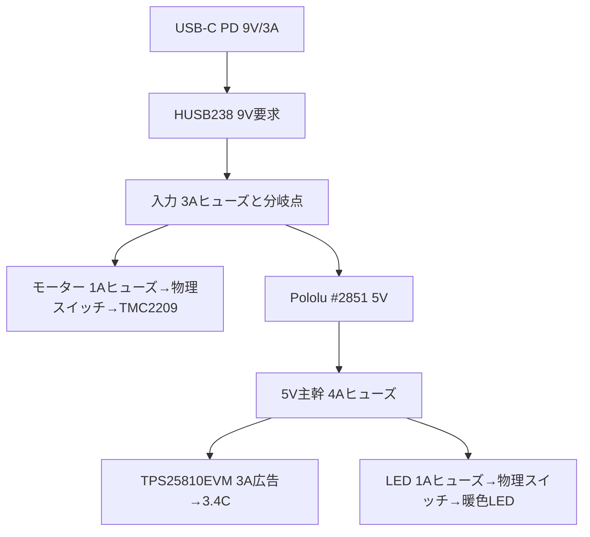

# Forest Guardian / DialCanvas Desk Edition — 設計ベースライン v0.21

- 基準日: 2026-10-21
- 状態: **一台試作の机上設計ベースライン。製作・通電・量産リリースではない**
- 要求台帳: [v0.21 requirements.yaml](../01-requirements/requirements.yaml)
- 決定記録: [ADR一覧](../../adr/README.md)
- 現在の作業/受入状態: [worklist.csv](worklist.csv)、[状態記録](status-2026-10-21.md)

この文書を現行Desk Editionの構成・インターフェース・候補値の統合基準とする。旧7軸設計の資料とブランチは履歴・参照専用で、新設計の要求、証拠、進捗へ混ぜない。部品、寸法、電気値に `PROVISIONAL` を付した項目は試作候補として一つに揃えた値であり、実物で受入れるまで製造値にはならない。

## 1. 製品の固定方針

- 製品は Forest Guardian / DialCanvas Desk Edition の一台用置き時計。
- 承認済み Forest Guardian の意匠、曲線ウォールナット外装、アンティークブラス色、暖色の間接照明を維持する。
- 基準外形は幅270 × 高さ205 × 奥行145 mm。最終外形は実部品・保護板・配線を含めて受入れる。
- 中央円形ディスプレイにアナログ文字盤画像とソフトウェア時計針を表示する。タッチ操作を使わない。
- 装飾歯車は静かなモーター1基で連動させる。**7軸固定でも歯車数固定でもない。** 28個のCADは配置候補に限る。
- 時刻計測と装飾歯車の制御は独立させる。モーター停止中も時計表示、SNTP同期、文字盤選択を継続する。
- 文字盤画像は電源OFF時にmicroSDへ追加・削除し、本体ロータリーエンコーダーで選択する。Web管理は初号機の範囲外。

## 2. システム構成

| サブシステム | ベースライン構成 | 状態 |
| --- | --- | --- |
| 表示・主制御 | Waveshare ESP32-P4-WIFI6-Touch-LCD-3.4C、SKU31523、3.4型円形IPS、800×800、USB TO UART Type-Cから5V給電 | 型番候補はPROVISIONAL。基板改版、取付、消費電力、画質は未受入 |
| 時刻 | Wi-Fi接続後SNTP。Adafruit DS3231 #3013をUTC保持用RTC候補として3.3V I²C接続。表示TZはJST (`JST-9`) | 構成PROVISIONAL。ネット断、電源断、電池保持は未受入 |
| 文字盤 | `DialCanvas/faces/<name>/face.jpg`、800×800 sRGB Baseline JPEG、最大8MiB、任意のversion 1 `dial.json`。既定文字盤は削除不可。SDは読取専用 | 形式FIXED。表示器上の操作と保持は未受入 |
| 入力 | ALPS EC11系ロータリーエンコーダー。回転でプレビュー、短押しで保存、900ms長押しで歯車の開始/停止要求 | 操作FIXED。GPIO割当はPROVISIONAL |
| 照明 | DFRobot FIT0836 5V暖色LED、330mm候補、独立SPSTスイッチ、乳白2mm拡散材 | 部品・光量・温度PROVISIONAL |
| 歯車駆動 | Adafruit NEMA-8 #4411、Adafruit TMC2209 #6121、単一駆動軸、出力軸1.6rpm候補 | 型番と電流設定PROVISIONAL。機構・静音性・熱は未受入 |
| 筐体 | ウォールナット木製ケース、透明前面ガード、前後整備、二層透明歯車支持板 | 寸法と材料PROVISIONAL。製造図と現物適合は未受入 |

## 3. 文字盤・時刻・操作インターフェース

| インターフェース | ベースライン |
| --- | --- |
| 表示器 | 3.4CのUSB TO UART Type-Cを通常時の5V入力に使う。40-pin GPIOヘッダーへ5Vを注入しない。画面は800×800、表示領域公称Ø87.6mm、基板公称115×115mm。 |
| サービス接続 | TPS25810EVM側のType-C sourceは給電用候補。書込み/デバッグ時はsource cableを外し、USB TO UART端子をPCへ接続する。二つの5V源を同時に接続しない。モーター電源スイッチはOFFにする。 |
| 文字盤媒体 | microSD直下の `DialCanvas/faces/` のみを走査。英数字・`_`・`-`の1〜32文字フォルダー名、JPEG 8MiB以下。フォーマットや自動修復はしない。 |
| 描画 | 時・分・秒の3針をミリ秒補間し、16ms間隔で更新要求する。16msは実測フレームレート保証ではない。最低30fps、目標60fpsの表示確認を実機受入条件とする。 |
| 時刻復旧 | 有効なDS3231 UTCを起動時に復元し、Wi-Fi接続後のSNTP値をRTCへ書く。ネットワークも有効RTC値もない場合は `TIME NOT SET` を表示する。 |
| 操作入力GPIO候補 | A=GPIO2、B=GPIO3、SW=GPIO21。 |
| RTC GPIO候補 | SDA=GPIO28、SCL=GPIO29、I²C1、3.3V。RTC端子やI²C電圧は正確な基板改版で照合する。 |
| モーターGPIO候補 | STEP=GPIO4、DIR=GPIO5、ENN=GPIO32。正確な基板改版と拡張端子を確認するまで配線しない。GPIO6は割当てない。 |

GPIO候補の一次資料はWaveshare [3.4C公式ドキュメント](https://docs.waveshare.com/ESP32-P4-WIFI6-Touch-LCD-XC)と[公式回路図](https://files.waveshare.com/wiki/ESP32-P4-WIFI6-Touch-LCD-XC/ESP32-P4-WIFI6-Touch-LCD-XC-Schematic.pdf)。GPIO表は候補割当であり、実物基板の改版確認を置き換えない。

## 4. モーターと機械構成

### 4.1 駆動パラメーター

| 項目 | 試作候補値 | 判定 |
| --- | --- | --- |
| モーター | Adafruit NEMA-8 #4411、200 full-step/rev、定格0.6A/相、4mm軸 | PROVISIONAL |
| ドライバー | Adafruit TMC2209 #6121、MS1/MS2開放の1/8分割候補、StealthChop候補 | PROVISIONAL。現物ボードのジャンパ/既定値を確認 |
| 電流 | 0.30A RMS/相から評価開始 | PROVISIONAL。実設定、トルク、脱調、温度を測定 |
| 速度 | ドライバー出力軸1.600rpm候補 | PROVISIONAL。負荷時に確認 |
| STEP | 42.666… pulse/s平均、23,437/23,438µsの分数周期、2,560 pulse/60s | Cコア計算とホスト試験済み。GPIO波形とモーター速度は未測定 |
| 停止 | ソフトウェア停止はENN HIGH。ハードウェア停止はVM直列の独立SPSTスイッチ | 回路構成PROVISIONAL。リセット時、遮断、再起動を試験 |

### 4.2 歯車と軸

- KHK DS1 M1 POM歯車、18/20/24/28T、5mm軸、二層配置を現行候補とする。
- 最新のCADは28個（前列A 14、後列B 14）、歯数内訳18T×11、20T×10、24T×3、28T×4。数量、座標、噛合い経路は実物試験により変更可能であり要求値ではない。
- 左側・下側へ寄せた不規則配置。異なるZ面の投影重なりを使い、歯面同士の投影干渉を避ける。
- 5mm軸とOILES #80 80B-0508ブッシュ候補、透明支持板2枚で支持する。ギアの穴公差、軸圧入、ブッシュ保持、支持板変形は未受入。
- 現行結合部品候補はNBK MJT-14-RD-4-5、4mm↔5mm、外径14mm、全長22mm。CAD名目位置z=48–70mm、モーター取付面z=72mm。
- CADは公称2D配置・外形包絡で、実歯形、公差、振れ、荷重、配線、板たわみを含まない。加工データへ直接使わない。

図面・座標の参照先は[歯車成立性ノート](../03-mechanical/gear-feasibility.md)、[28歯車配置SVG](../03-mechanical/irregular_layered_gear_layout.svg)、[軸方向断面SVG](../03-mechanical/layered_gear_axial_section.svg)、[軸表CSV](../03-mechanical/gear_axis_schedule.csv)、[3D包絡レビュー](../03-mechanical/cots_clock_envelope_review.md)。

## 5. 筐体・整備

| 項目 | 名目設計 |
| --- | --- |
| ケース外寸 | 270×205×145mm |
| 内寸 | 246×181×121mm、側板12mmを前提にした候補 |
| 材料 | 曲線部はウォールナット無垢材、広い化粧面はウォールナット突板候補 |
| 支持板 | 透明PC 8mm、252×187mmを2枚。板外周を側壁溝で捕捉する候補 |
| 前面保護 | 透明PC 3mm、周縁捕捉、着脱式押さえ縁。材料反射/傷、たわみ、保持、指到達を実物確認 |
| 前面支持板 | z=0–8mm、中央Ø112mm開口候補 |
| 表示基板 | 後面支持板の120×120mm開口へ配置。公称115mm基板外形との名目隙間2.5mm/辺。表示ガラス基準z=40mm |
| 後面支持板 | z=36–44mm。部品高さ、USB/SD挿抜、熱、ケーブル曲げは未計測 |
| ギア層 | A/B歯面を別Z面に配置し、名目2mmの歯幅方向間隔を取る |
| 背面整備 | 背面板をねじ止めで外せる構成。支持板と表示器を背面から点検できる候補 |
| モーター | カップリングz=48–70mm、NEMA-8取付面z=72mm、ケース内壁z=121mm。公称後方余裕16mm |

公称寸法は一台用包絡モデルの基準であり、最終内寸・溝・穴径・保護板保持形状は実物部品と試験片の測定後に図面化する。承認済み外観の高解像度原画と利用条件はFG-038/OQ-10に残る。

## 6. 電源とモーター保護

### 6.1 電源の流れ

9Vのモーター戻りと5V/表示の戻りは、電源分岐点まで別配線とする。モーター相電流を表示器のGND配線やUSBケーブルへ流さない。ヒューズ値は一台試作の候補値で、導線・コネクター・突入・故障試験後に確定する。

| 電源経路 | 試作ベースライン | 保護/検証 |
| --- | --- | --- |
| ACアダプター | Anker 511 Charger (Nano 3, 30W) とUSB-C PDケーブル | 9V/3A PDOを持つ候補。HUSB238のPD契約を実測 |
| PDシンク | Adafruit HUSB238 #5807。9V固定要求、3A設定 | 契約失敗時は5V側へ安全に停止すること、極性・出力電圧を実測 |
| 9V入力 | 3Aヒューズ候補後に星形分岐 | ヒューズ定格/時間特性、入力電圧、全負荷電流を確認 |
| 5V変換 | Pololu D24V50F5 #2851、9V→5V | 公称typical continuous up to 5A、温度依存。5Aを筐体内連続許容量とはみなさない |
| 5V主幹 | 4Aヒューズ候補 | #2851、基板、端子、配線の定格に合わせて検証 |
| 表示USB-C source | TI TPS25810EVM-745、TPS25810 DFP、3A広告設定 | 5V入力。ICの電流制限は3A広告時typ.3.40Aだが、USB-C sinkへ3.4A引出しを許可する意味ではない。CC設定・動作・温度を確認 |
| 表示ケーブル | ELECOM MPA-XCCECSS03BK、C-C、0.3m | EVM sourceから3.4C USB TO UART入力。基板改版指定入力と電圧降下を測定 |
| モーター | 9V分岐→1Aヒューズ候補→NKK MN11SS1W01 SPST→TMC2209 VM | 旧M1 eFuseを使わない独立枝。スイッチOFFでVMを直接遮断 |
| モーター抑止 | ENNはactive-low。10kΩでENNをVIO/3.3Vへ外部プルアップ。GPIOは初期化時にENN HIGH。STEPは外部10kΩ pulldown候補 | reset/brownout/未接続/長押し停止を試験。実ドライバー基板の論理極性を確認 |
| VM過電圧 | SMBJ12A TVSをTMC2209 VM/GND近傍へ、ドライバー基板の既設コンデンサーと併用 | VRWM=12V、仕様上最大クランプ19.9V候補。回生エネルギーと実波形は未受入 |
| LED | 5V分岐→1Aヒューズ候補→独立SPST→FIT0836 330mm | 4W/m仕様値による最大1.32W/0.264Aの計算。電流、拡散、木部温度を測定 |

TPS25810EVM-745は評価用基板で、量産モジュールではない。TIガイド記載の3A広告ジャンパ設定を用い、実Type-Cケーブル使用時はCCテストジャンパを外す。評価基板そのものの取付、5V入力端子、ジャック、ジャンパ保持、入手性を確認する。設計上の意図はPololu #3411の手作業CC抵抗変更を避けること。

### 6.2 静的電力予算

次の値は候補仕様と仮定からの計算で、実測値ではない。

| 負荷/条件 | 計算 |
| --- | ---: |
| 表示sourceの広告上限 | 5V×3A = 15W |
| LED 330mm | 4W/m×0.330m = 1.32W、0.264A@5V |
| #2851の5V側合計上限 | 15W+1.32W = 16.32W、約3.264A |
| #2851入力側（効率85%仮定） | 約19.2W、約2.13A@9V |
| モーター巻線銅損（0.30A RMS/相、6.5Ω/相仮定） | 2×0.30²×6.5 = 約1.17W。ドライバー損失は別途 |
| 参考総負荷 | モーター枝の変換効率を仮に85%と置くと約20.6W、約2.29A@9V |
| 9V PD候補との参考差 | 27W−20.6W = 約6.4W (約24%) |

この余裕値は設計採否の証明ではない。表示器の実ピーク、無線送信、microSD、モーター電流波形、変換効率、起動電流、閉箱温度、PD再交渉を同時測定するまではFG-048をOPENとする。

## 7. 実機受入の定義

段階と暫定pass条件は[一台試作受入計画v0.21](../09-verification/prototype-acceptance-plan-v0.21.md)に定義する。

| ID | 実機で記録するもの | 完了条件 |
| --- | --- | --- |
| DR-02 | 3.4C現物改版、電源/USB/UART/SD/表示、各GPIOとEN | 一次資料と基板現物の対応表、全候補GPIOの未競合確認。ESP-IDFビルドのみでは完了しない |
| DR-03 | JPEG表示、エンコーダー、SD読取専用、選択NVS、針描画、SNTP/RTC | 起動/再起動、ネット断、時刻復旧、30fps最低/60fps目標の記録 |
| DR-04 | ギア嵌合、1.6rpm、逆回転、始動/再始動、連続運転、騒音/振動/温度 | 無通電手回しから段階実施し、負荷/停止時も噛合いと静音目標を満たす |
| DR-05 | PD 9V/3A、枝電流/電圧降下、短絡/過負荷、ヒューズ、TVS、閉箱温度 | 5V・9Vの定常/起動/異常記録。保護部品と配線の定格が測定値へ適合 |
| DR-06 | 前面ガード、支持板、保護、指到達防止、表示取付、端子/カード挿抜、前後整備 | 原本外観と実寸部品に整合する製作図、BOM、組立・検査順が同一改版で揃う |
| DR-07 | DR-01〜06証拠、未解決リスク、リリースレビュー | DR-02〜06がPASSし、別途の製作許可が記録されるまでHOLD |

## 8. 状態の読み方

要求の状態語は要求台帳と同じ意味で使う。

- `FIXED`: ユーザー要求または現行方針として固定。
- `PROVISIONAL`: 一台試作に使う候補値。測定で変更可能。
- `OPEN`: 決定または検証が残る。
- `REJECTED`: 現行範囲に採用しない。
- `SUPERSEDED`: 旧案として置換済み。

作業一覧の `DesignStatus` は設計文書の整備状態、`ValidationStatus` は根拠/受入状態を表す。`BASELINED` は候補設計が具体化され、次に検証できる状態を示す。実機の未検証項目を完了に読み替えない。

## 9. 参照資料

- Waveshare [3.4C公式製品/基板資料](https://docs.waveshare.com/ESP32-P4-WIFI6-Touch-LCD-XC)、[公式回路図](https://files.waveshare.com/wiki/ESP32-P4-WIFI6-Touch-LCD-XC/ESP32-P4-WIFI6-Touch-LCD-XC-Schematic.pdf)
- TI [TPS25810EVM-745製品](https://www.ti.com/tool/TPS25810EVM-745)、[TPS25810EVM-745 User's Guide](https://www.ti.com/lit/pdf/slvuai0)
- Pololu [D24V50F5 #2851](https://www.pololu.com/product/2851)
- Adafruit [NEMA-8 #4411](https://www.adafruit.com/product/4411)、[TMC2209 #6121](https://www.adafruit.com/product/6121)、[HUSB238 #5807](https://www.adafruit.com/product/5807)、[DS3231 #3013](https://www.adafruit.com/product/3013)
- Analog Devices [TMC2209 data sheet](https://www.analog.com/media/en/technical-documentation/data-sheets/TMC2209_datasheet_rev1.09.pdf)
- Littelfuse [SMBJ12A](https://www.littelfuse.com/ja-jp/products/overvoltage-protection/tvs-diodes/surface-mount/smbj/smbj12a)
- 機構/取付候補: [KHK DS歯車](https://khkgears.net/pdf/ds.pdf)、[OILES #80](https://www.oiles.co.jp/en/products/bearing/assets/oiles-80_en.pdf)、[NBK MJT継手](https://www.nbk1560.com/products/coupling/couplicon/jaw_type/MJT-RD/)
